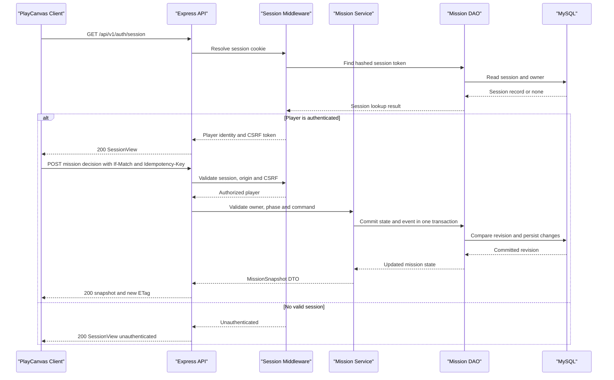

# t3 — Target Architecture and API Contracts

## Design decision

Rebuild the browser client as a native, routed PlayCanvas 3D application and use one deployable Express API, organized as a modular monolith, backed by MySQL. Keep bounded domain modules and explicit service/DAO/DTO boundaries inside the API; do not make every mission activity a separately deployed microservice. Mission decisions update one authoritative server-side state and need transactional consistency, while no current evidence justifies the operational and network cost of distributed services.

The legacy `Go-No-Go.html` is a read-only behavior and import-format reference. It is not served, copied, embedded, or used as a gameplay fallback in development or production. Rebuild all inventoried flows; do not mark a flow complete because its legacy implementation remains in the repository.

## Runtime and module boundaries

| Runtime unit | Proposed responsibility | Boundary |
|---|---|---|
| `app/frontend` | Vite SPA, route shell, PlayCanvas scene and first-person controls, accessible Tailwind DOM UI, Italian/English content, minimal API-backed view state | Owns camera/input/UI presentation only. The scene and forms never determine canonical mission progression or claim a write was saved before API confirmation. |
| `app/contracts` | Versioned, framework-independent HTTP DTOs and shared validation/type contracts | Public request/response shapes only; no database row/entity or game-rule implementation. Both client and API consume the same versioned contract definitions. |
| `app/backend` | Express 5 HTTP API and application/domain modules | Owns identity, authorization, authoritative game rules, mission transitions, import orchestration and persistence transactions. One process/deployment for the initial product. |
| MySQL | Account/session, agency, mission, decision, test, operation and import data | Persistence and transaction boundary defined with the DBA schema artifact; SQL is accessed only through DAOs/repositories. |

Suggested source layout (design target; no files are created by this task):

```text
app/
  contracts/src/v1/              # DTOs, enums, schemas, API error shape
  frontend/src/
    app/router/                  # /, /profile, /missions, /missions/:missionId
    game/                        # PlayCanvas world, lunar scene, input adapters
    features/                    # route panels and localized activity workflows
    api/                         # typed HTTP client; cookie/CSRF/revision handling
  backend/src/
    http/v1/                     # routers, controllers, auth/CSRF/error middleware
    application/                 # auth, profile, agency, mission, report, import use cases
    domain/                      # authoritative mission/phase/readiness rules
    persistence/dao/             # repository interfaces and MySQL implementations
    config/                      # validated environment configuration
    migrations/                  # ordered schema migrations (coordinate with DBA)
```

### Request and state ownership

1. The browser route loads the application shell; the PlayCanvas 2.12.x scene owns local movement, camera, rendering, and non-persistent interaction affordances. Semantic DOM provides the equivalent activity map and all mission-critical forms/decisions.
2. The typed API client sends DTOs to `/api/v1`. The Express controller validates transport input and identity, then invokes one application use case.
3. The application/domain service authorizes ownership, recalculates rules and derived results, and calls DAOs. A MySQL transaction commits the state change and its decision/audit history together.
4. The response is a DTO projection (never a SQL row/domain object); it includes the new mission revision. The client replaces its confirmed view state only after the response. Offline/pending edits are visibly unconfirmed and never masquerade as persisted progress.

Mission state, budgets, phase gates, requirements, engineering checks, test validity, launch readiness, operations consequences, outcomes and reports are server-authoritative. The client may display previews but cannot write derived values or advance a phase locally. Scene transforms and control preferences remain client-side; persisted player preferences are explicit profile DTOs. Local storage is not a second mission database; retain `gng32.save` unchanged unless the player separately chooses to remove it.

### Backend layers and invariants

- **Router/controller:** HTTP parsing, DTO validation, authentication/CSRF/ownership middleware, status and response mapping. Controllers do not execute SQL or implement mission rules.
- **Application services:** one use case per externally requested action (e.g. decide requirement, save design, run test, launch, import save); orchestration and transaction boundaries.
- **Domain:** explicit phase/state transitions, constraints, requirements, and consequence calculations. Invalid transitions return a domain error; the client cannot bypass a locked activity by calling an endpoint directly.
- **DAO/repository:** narrowly scoped account, session, agency, mission, report and import persistence operations. DAOs accept domain/query inputs and return domain data; no route or frontend imports a DAO.
- **DTO:** request/response schemas live under the versioned contracts boundary. Never return password hashes, session token hashes, internal SQL metadata, or unfiltered legacy payloads.
- **Transaction:** every accepted mission command writes the updated mission state and its decision/event record atomically. A failed command makes no partial domain update. Related test invalidation and readiness recalculation are part of the same transaction.
- **Ownership:** every profile, agency, mission, report and import lookup is scoped to the authenticated player before returning data. For an unknown or non-owned resource return the same `404` shape to avoid confirming another player's identifier.

## API conventions

- JSON REST API at `/api/v1`; all route examples below are relative to that prefix. Breaking changes are allowed by the approved decision; future incompatible contracts use `/api/v2`, not silent in-place reinterpretation.
- Use `application/json`, UTF-8, strict runtime validation and bounded request sizes. DTOs are camelCase, enums are stable lowercase strings. Unknown/malformed commands fail explicitly; do not silently ignore mission-state fields.
- `GET` reads are side-effect-free. Every unsafe method validates same-origin `Origin`; authenticated unsafe methods additionally require a session-bound CSRF token in `X-CSRF-Token`. Anonymous register/login use origin and same-site fetch-metadata checks plus rate limits because no authenticated CSRF session exists yet. Authenticated browser calls use same-origin cookies and `credentials: "include"`; never put session tokens in URLs or web storage.
- Mission and agency mutation requests carry `If-Match: "<revision>"`; a successful mutation returns the updated DTO and new `ETag`. Missing precondition returns `428 PRECONDITION_REQUIRED`; stale revision returns `412 REVISION_CONFLICT` with a safe current revision and refetch instruction. Never last-write-wins over newer progress.
- Retryable create/command/import POSTs require an `Idempotency-Key` UUID. The server binds a key to the authenticated player, operation and request digest; same-key/same-request retry replays the original result, while same-key/different-request returns `409 IDEMPOTENCY_KEY_REUSED`.
- Common error envelope:

```json
{
  "error": {
    "code": "REVISION_CONFLICT",
    "messageKey": "errors.revisionConflict",
    "fieldErrors": [],
    "requestId": "opaque-correlation-id"
  }
}
```

`messageKey` is localized by the client into Italian or English; safe `fieldErrors` identify input locations but never echo passwords, session data or internal diagnostics. Use `400` malformed transport, `401` no valid session, `403` CSRF/policy rejection, `404` missing or non-owned resource, `409` domain/idempotency conflict, `412` stale `If-Match`, `422` valid JSON with invalid domain/DTO data, `429` rate limit and `503` dependency unavailable. Never return stack traces.

## HTTP API contract

All success response names are DTOs described below. Bodyless operations return `204`. All player-specific rows require an authenticated player unless marked public. Mutation requirements in the conventions apply in addition to the headers shown here.

| Method and path | Auth | Request DTO / query | Success response | Contract and principal errors |
|---|---|---|---|---|
| `GET /api/health/live` | No | None | `LiveHealthView` (`200`) | Process liveness only; no database dependency. |
| `GET /api/health/ready` | No | None | `ReadyHealthView` (`200`) | `503` unless MySQL is reachable and required migrations are compatible. Do not report ready from process liveness alone. |
| `POST /api/v1/auth/register` | No | `RegisterPlayerRequest` | `PlayerSessionView` (`201`), sets session cookie | Validate and hash password; rate-limit. `400/409/422/429`. Do not log request body. |
| `POST /api/v1/auth/login` | No | `LoginRequest` | `PlayerSessionView` (`200`), sets rotated session cookie | Generic credential failure response; rate-limit. `401/422/429`. |
| `POST /api/v1/auth/logout` | Session + CSRF | None | `204`, expires cookie and revokes session | Idempotent logout. |
| `GET /api/v1/auth/session` | Optional | Session cookie | `SessionView` (`200`) | Returns `{authenticated:false}` when signed out; authenticated response includes the player summary and a session-bound CSRF token for this page session. |
| `GET /api/v1/profile` | Session | None | `ProfileView` (`200`) | Own profile and progression summary only. |
| `PATCH /api/v1/profile` | Session + CSRF | `UpdateProfileRequest` | `ProfileView` (`200`) | Only explicitly editable profile/preferences fields; `422` invalid locale/settings. |
| `PATCH /api/v1/profile/tutorial` | Session + CSRF | `TutorialProgressRequest` | `TutorialProgressView` (`200`) | Persists started/skipped/completed progress; tutorial skip is explicit. |
| `GET /api/v1/agencies` | Session | `status?`, `cursor?`, `limit?` | `AgencyListView` (`200`) | Only agencies owned by player. |
| `POST /api/v1/agencies` | Session + CSRF | `CreateAgencyRequest` | `AgencyView` (`201`) | Creates a new campaign/agency; idempotent retry. |
| `GET /api/v1/agencies/{agencyId}` | Session | None | `AgencyView` (`200`) | Includes derived resources, staff/progression/unlocks and capacity; `404` if absent or non-owned. |
| `POST /api/v1/agencies/{agencyId}/staff-actions` | Session + CSRF + `If-Match` | `AgencyStaffActionRequest` | `AgencyView` (`200`) | Server checks affordability, capacity and action validity; resource changes are server-derived. |
| `POST /api/v1/agencies/{agencyId}/facility-upgrades` | Session + CSRF + `If-Match` | `FacilityUpgradeRequest` | `AgencyView` (`200`) | Server checks current unlocks/costs and applies one atomic update. |
| `POST /api/v1/agencies/{agencyId}/reset` | Session + CSRF + `If-Match` | `ResetAgencyRequest` | `AgencyResetView` (`200`) | Explicit, confirmed reset/restart only; archive/preserve existing campaign data rather than silently deleting it. |
| `GET /api/v1/agencies/{agencyId}/roadmap` | Session | None | `RoadmapView` (`200`) | Returns source-supported progression/unlock roadmap for that owned agency. |
| `GET /api/v1/agencies/{agencyId}/rankings` | Session | `scope?` | `RankingView` (`200`) | Only supported ranking views; do not expose player email or private mission details. |
| `GET /api/v1/missions` | Session | `agencyId?`, `status?`, `cursor?`, `limit?` | `MissionListView` (`200`) | Active/completed mission summaries, owner-scoped and paginated. |
| `POST /api/v1/missions` | Session + CSRF | `CreateMissionRequest` | `MissionSnapshot` (`201`) | Checks agency ownership, mission capacity and allowed context; `409` capacity/limit. |
| `GET /api/v1/missions/{missionId}` | Session | None | `MissionSnapshot` (`200`) + `ETag` | Returns authoritative current mission and activity availability. |
| `PATCH /api/v1/missions/{missionId}` | Session + CSRF + `If-Match` | `UpdateMissionRequest` | `MissionSnapshot` (`200`) + `ETag` | Limits edits to explicitly editable metadata such as name; no arbitrary state replacement. |
| `GET /api/v1/missions/{missionId}/participants` | Session | None | `ParticipantListView` (`200`) | Includes available stakeholders and NASA as required by the source behavior. |
| `PUT /api/v1/missions/{missionId}/participants` | Session + CSRF + `If-Match` | `SetParticipantsRequest` | `MissionSnapshot` (`200`) + `ETag` | Server validates eligibility and recalculates affected requirements/consequences. |
| `POST /api/v1/missions/{missionId}/requirement-decisions` | Session + CSRF + `If-Match` | `RequirementDecisionRequest` | `MissionSnapshot` (`200`) + `ETag` | Accept, qualify, decline or waive a named requirement; preserve downstream effects. |
| `PUT /api/v1/missions/{missionId}/spacecraft/design` | Session + CSRF + `If-Match` | `SpacecraftDesignRequest` | `DesignCheckView` (`200`) + `ETag` | Server validates component placement/compatibility and derives fit, mass, power, energy, pointing, budget and requirement checks. Invalid design returns `422` with actionable issues; it is not saved as passing. |
| `PUT /api/v1/missions/{missionId}/flight-plan` | Session + CSRF + `If-Match` | `FlightPlanRequest` | `FlightPlanCheckView` (`200`) + `ETag` | Server validates destination/orbit, launch compatibility, transfer/maneuvers and delta-v feasibility; returns explicit blockers/trade-offs. |
| `POST /api/v1/missions/{missionId}/assembly` | Session + CSRF + `If-Match` | `AssemblyCommandRequest` | `AssemblyView` (`200`) + `ETag` | Starts/advances a source-supported assembly activity; only server-validated completion enables test flow. |
| `GET /api/v1/missions/{missionId}/tests` | Session | None | `QualificationView` (`200`) | Lists functional, vibration, thermal-vacuum, shock, EMC and mass test status, including invalidated results. |
| `POST /api/v1/missions/{missionId}/tests` | Session + CSRF + `If-Match` | `RunQualificationRequest` | `TestRunView` (`201`) + new `ETag` | Starts one applicable test; result and failure explanation are explicit. Idempotent by key. |
| `POST /api/v1/missions/{missionId}/tests/{testRunId}/repairs` | Session + CSRF + `If-Match` | `RepairRequest` | `MissionSnapshot` (`200`) + `ETag` | Applies an eligible repair/design change and invalidates affected qualification results. |
| `POST /api/v1/missions/{missionId}/reviews/preview` | Session + CSRF | `ReviewPreviewRequest` | `ReviewPreviewView` (`200`) | Side-effect-free consequence preview for a gate or earlier-phase rework, including costs, schedule, approvals and tests affected. |
| `POST /api/v1/missions/{missionId}/reviews` | Session + CSRF + `If-Match` | `ReviewDecisionRequest` | `MissionSnapshot` (`200`) + `ETag` | Records explicit gate/rework decision; server blocks GO with exact unmet requirements/tests. |
| `POST /api/v1/missions/{missionId}/launch` | Session + CSRF + `If-Match` | `LaunchRequest` | `MissionSnapshot` (`200`) + `ETag` | Accepts launch only after current readiness checks; launch transition follows explicit player confirmation. |
| `GET /api/v1/missions/{missionId}/operations` | Session | None | `OperationsView` (`200`) | Current flight status, resources, events and recorded decisions. |
| `POST /api/v1/missions/{missionId}/operation-decisions` | Session + CSRF + `If-Match` | `OperationDecisionRequest` | `OperationsView` (`200`) + `ETag` | Records a valid response to a current event and derives resource/outcome consequences. |
| `GET /api/v1/missions/{missionId}/report` | Session | None | `MissionReportView` (`200`) | Requires closeout; includes honest outcome, factors, science and financial/resource summary. |
| `POST /api/v1/missions/{missionId}/analyses` | Session + CSRF | `MissionAnalysisRequest` | `MissionAnalysisView` (`200`) | Supports source-present compare/what-if actions; labels simulated assumptions/results separately from actual report. |
| `POST /api/v1/imports/legacy-v32` | Session + CSRF | `LegacyV32ImportRequest`, `Idempotency-Key` | `LegacyImportResultView` (`201` or replayed result) | Called only after affirmative UI consent and only then read from local storage. Strictly validate v32 shape; atomically import or write nothing. Rejection, malformed/unsupported data or failure leaves the browser key unchanged. |

`ReadyHealthView` must avoid leaking secrets or internal connection strings. The old `GET /api/health` is not a gameplay contract; the approved breaking-change policy allows separate liveness/readiness semantics. If an operator-facing deployment requires the old path, it may alias liveness temporarily, but client code must use the explicit new paths.

## DTO and validation boundaries

Shared DTOs are immutable transport projections with explicit request and response roles. Runtime validation is required at the server boundary; TypeScript compile-time types alone do not validate untrusted JSON. The client should also validate unexpected response shapes before using them to render or change confirmed state.

| DTO family | Examples and API role |
|---|---|
| Identity | `RegisterPlayerRequest`, `LoginRequest` (request bodies); `PlayerSessionView`, `SessionView`, `ProfileView` (responses; never include hash/token secrets). |
| Agency | `CreateAgencyRequest`, `AgencyStaffActionRequest`, `FacilityUpgradeRequest`, `ResetAgencyRequest` (commands); `AgencyView`, `AgencyResetView`, `RoadmapView`, `RankingView` (responses). |
| Mission | `CreateMissionRequest`, `UpdateMissionRequest`, `MissionSnapshot`, `MissionSummary`, `MissionListView`; snapshot contains lifecycle phase, server-derived blockers/resources, activity availability and monotonically increasing revision, not a MySQL entity. |
| Decisions | `ParticipantListView`, `SetParticipantsRequest`, `RequirementDecisionRequest`, `ReviewPreviewRequest/View`, `ReviewDecisionRequest`; explicit enums make outcomes/actions auditable. |
| Engineering | `SpacecraftDesignRequest`, `DesignCheckView`, `FlightPlanRequest`, `FlightPlanCheckView`, `AssemblyCommandRequest/View`, `RunQualificationRequest`, `TestRunView`, `RepairRequest`, `QualificationView`. |
| Flight and analysis | `LaunchRequest`, `OperationsView`, `OperationDecisionRequest`, `MissionReportView`, `MissionAnalysisRequest/View`; actual mission history is distinct from simulated analysis. |
| Import and errors | `LegacyV32ImportRequest`, `LegacyImportResultView`, `ApiError`; legacy payload is validated with a dedicated v32 adapter and is never exposed as a general domain DTO. |

DAOs map database records to internal domain objects; application services map domain objects into DTOs. No API accepts a whole serialized agency/mission object for blind replacement. No browser code depends on DAO entities or database table/column names. The t4 DBA artifact owns the physical MySQL schema and must satisfy the ownership, atomicity, unique-import, revision and persistence invariants above.

## Authentication and session handling

- Hash passwords with Argon2id and a maintained library, with work parameters configurable and upgraded on successful authentication when policy changes. Normalize email for uniqueness; never store or log plaintext passwords.
- Use an opaque cryptographically random session identifier in a `__Host-gng_session` cookie: `HttpOnly`, `Secure` in production, `SameSite=Lax`, `Path=/`, no `Domain`, finite idle/absolute expiry. Store only a one-way hash of the token in MySQL; rotate after login/privilege changes and revoke on logout/password change.
- Production API and frontend are same-origin. Validate `Origin` for state-changing requests, enforce session-bound CSRF header, restrictive security headers and a request-size limit. Do not enable wildcard credentialed CORS.
- Rate-limit register/login and return a generic invalid-credentials message. Do not reveal whether a particular email is registered. Session and CSRF values are never written to localStorage, URLs, telemetry or startup logs.
- Use environment configuration for database credentials, cookie/security mode, allowed origin, server port and session policy. Validate required configuration at startup; report missing variable names/actionable guidance without printing values. Readiness remains false until the database and required schema are usable.

## Legacy v32 import protocol

1. A signed-in player opens the profile import action and affirmatively consents to reading and uploading the local save. Before consent, the UI may inspect localStorage key names to offer the action but must not call `getItem('gng32.save')`, parse the value, upload it or mutate it.
2. After consent, the client reads the exact source value, parses it locally for a useful error, verifies `v === 32`, then submits `LegacyV32ImportRequest` with `consent: true`, source version, payload and a stable idempotency key. Server validation is authoritative and covers the complete supported nested shape, not just `v`.
3. The backend maps through a dedicated `LegacyV32Importer` into new domain objects; validate before transaction. Import all-or-nothing. Persist an import identity/digest unique per owner so same-save retries or replayed requests do not create duplicate missions. Same key with changed payload is rejected.
4. If any data cannot be mapped faithfully, return a structured `422` and make no writes rather than silently dropping it. On a committed import, return counts and any explicitly described compatibility notes.
5. Keep the original `gng32.save` bytes untouched on decline, validation failure, network ambiguity, server failure and success. Never auto-delete it after a successful import; only a separate explicit user reset/removal action may remove local legacy data.

The designer and DBA must jointly confirm complete v32 field coverage against `Go-No-Go.html` before implementation. This API shape does not assert that the importer or any field mapping already exists.

## Cross-cutting behavior coverage

| Upstream behavior | Owning client/API areas | Required proof at implementation/validation |
|---|---|---|
| INV-01 tutorial; INV-14 immersive access | `/`, `/profile/tutorial`, first-person world, DOM activity map | Start, skip, resume/complete, and safe return; no gameplay iframe. |
| INV-02 agency lifecycle; INV-03 campus | Agency routes, mission list/snapshot activity catalog, scene and equivalent labeled map | Resource/capacity feedback; every station reachable and has return path. |
| INV-04 stakeholder/requirements; INV-05 phase gates/rework | Participants, requirement decisions, review preview/decision APIs | Consequences visible; GO blocked until server checks pass; rework preview precedes commit. |
| INV-06 spacecraft; INV-07 flight dynamics | Design and flight-plan APIs | Server-derived constraint checks and actionable invalid-choice errors. |
| INV-08 assembly; INV-09 tests | Assembly, qualification, repair APIs | Six test classes; design changes invalidate affected results; no readiness on stale/failing tests. |
| INV-10 launch/operations; INV-11 report/analysis | Launch, operations decisions, report and analysis APIs | Explicit launch; event decisions persisted; honest closeout and distinct actual/simulated reports. |
| INV-12 local continuity/settings; INV-13 account and online continuity | Profile/preferences, auth/session, import | Italian/English; explicit reset; owned missions load cross-session; no silent import/overwrite. |
| INV-14 accessible first-person interface | Frontend only plus typed API errors/status | Touch and keyboard/mouse actions have equivalent outcomes; semantic DOM remains complete without pointer lock. |

This mapping is a contract, not completion evidence. The PM inventory's INV-01…INV-14 and REQ-001…REQ-024 remain implementation gates; unfinished flows must be reported honestly.

## Operational and migration decisions

- Pin `playcanvas` to exact version **`2.12.4`** in the frontend manifest and lockfile, not `^2.12.2` or `2.23.3`. `npm view playcanvas@2.12 version --json` returned `2.12.0` through `2.12.4`; `2.12.4` is the latest published patch in the required line at task time. The official PlayCanvas versioning guide confirms caret ranges permit later minor releases and documents exact-version installation. This selection is a package-version fact, not proof the current code compiles; the implementation build must verify API compatibility against the pinned lockfile.
- Keep the existing root npm-workspace shape where practical; add `app/contracts` only if shared runtime schemas/types can be built reproducibly by root scripts. Root `npm run dev`, `npm run build`, and `npm test` are the developer-facing commands; local MySQL setup is documented by the DBA/DevOps artifacts and must not require public-cloud credentials.
- Keep module migrations ordered and append-only; application startup must not silently mutate an incompatible production schema. `ready` reports schema incompatibility and directs operators to the migration command.
- Use synchronous HTTP request/response for current gameplay commands and MySQL transactions; no message broker or cross-service RPC is needed for this single-player game baseline. Add asynchronous processing only for measured long-running work, with durable job state and a client-visible pending status.
- Deployment topology, secret provisioning, and production SLA numbers remain deployment/operations decisions. The clarification's “match current production baseline” has no measured baseline; do not claim a numeric availability/latency target. No public deployment or real credentials are part of this design task.

### Risks and mitigations

| Severity | Risk | Design mitigation / exit evidence |
|---|---|---|
| HIGH | Existing gameplay rules are coupled to a large legacy page; API-only shell work can mask missing game flows. | Rebuild against every inventory group, keep a flow-to-UI/API/test matrix, and block complete-parity claims until each flow has runtime evidence. |
| HIGH | v32 import could lose or duplicate user data. | Explicit consent before value read, complete strict adapter, all-or-nothing transaction, owner/digest deduplication, stable idempotency and source-key preservation. |
| HIGH | Open PlayCanvas semver range can resolve outside the approved line. | Exact `2.12.4` pin and lockfile; run full build and desktop/mobile smoke checks on that exact version. |
| HIGH | Touch device construction could be mistaken for touch support. | Shared input action model plus tested movement/look/interact/pause and equivalent semantic activity navigation on representative mobile browsers. |
| HIGH | Cross-device edits could overwrite each other. | Resource ETags/`If-Match`, explicit `412` conflict path, no silent last-write-wins. |
| MEDIUM | The requested production-baseline SLA is unmeasured. | Establish production latency/availability baseline before asserting no-regression numbers; provide liveness/readiness distinction now. |

## Primary API flow

The diagram shows the cookie session lookup followed by a revision-guarded mission command. It omits import details, which are specified in the protocol above.

<!-- mermaid-checked: every participant uses `participant Id as "Label"`, no \n in aliases/messages/notes, every alt/opt/loop closed by end, no `:` inside any alias -->


## Upstream Artifacts Consumed

- `.github/modernize/rearchitecture/artifacts/t1-pm.md` — inventory groups INV-01…INV-14, REQ-001…REQ-024, data behaviors and acceptance gates.
- `.github/modernize/rearchitecture/artifacts/t2-architect.md` — current runtime split, health-only API, iframe/localStorage boundaries, installed dependency evidence and risks.
- `.github/modernize/rearchitecture/artifacts/t2.1-architect.md` — mandatory HIGH-gap mitigation contracts and required exit evidence.
- `.github/modernize/rearchitecture/artifacts/t5-ux.md` — dedicated routes, two entrances to each activity, input/accessibility and persistence interaction contracts.
- `.github/modernize/rearchitecture/artifacts/migration_boundary.yaml` — files in runtime rewrite scope and legacy HTML permitted only as reference.
- `.github/modernize/rearchitecture/artifacts/wire_contracts.yaml` — existing health contract and approval to change it.
- `.github/modernize/rearchitecture/artifacts/data-model.md` — observed legacy version-32 root state and non-destructive import boundary.
- `.github/modernize/rearchitecture/artifacts/tech-stack.md` — current packages, missing tests/auth/DB and PlayCanvas semver drift.
- `.github/modernize/rearchitecture/clarification.md` and `clarification-answers.md` — approved stack, data/auth policies, routes, locale, accessibility and mobile scope.
- `.github/modernize/rearchitecture/decisions.md` — approved no-iframe runtime and immutable PlayCanvas 2.12.x target.
- `.github/modernize/rearchitecture/learnings/architect/legacy-iframe-runtime-boundary.md` — trace iframe/build wiring and preserve local data.
- `.github/modernize/rearchitecture/learnings/architect/high-baseline-gap-dispositions.md` — convert baseline HIGH gaps into observable implementation gates.
- PlayCanvas official versioning documentation and npm registry metadata — exact pin rationale for 2.12.4 (links below).

## Evidence Mapping

- `t1-pm.md#INV-01–INV-14` and `#REQ-001–REQ-024` → cross-cutting coverage matrix, route/DTO ownership and API command inventory.
- `t2-architect.md#Key Risk Evidence` and `#Revalidation` → runtime module split, current health-only API, local-save and dependency migration boundary.
- `t2.1-architect.md#Mitigation contract` and `#Exit gate` → HIGH-risk table and import, touch, version-pin, conflict and parity gates.
- `t5-ux.md#Information architecture and routes` and `#Campus activity map` → browser routes, server activity availability and equivalent DOM activity path.
- `t5-ux.md#Accessibility and inclusive interaction requirements` and `#Mobile touch` → client/UI boundary and touch/keyboard parity requirement.
- `migration_boundary.yaml::must_rewrite` and `legacy_allowed_to_remain` → no-iframe runtime; legacy HTML stays reference-only.
- `wire_contracts.yaml::Backend liveness endpoint` → explicit liveness/readiness target endpoints under the approved API-breaking policy.
- `data-model.md#Root game-state fields observed` and `t2.1-architect.md#Persistence/import cutover` → strict v32 adapter, explicit consent, atomic idempotent import and original-key preservation.
- `clarification-answers.md#F1–F10, B1–B5, G1–G5` → approved stack, routes, API freedom, auth, persistence, full-flow/mobile/accessibility requirements.
- Official versioning guide (`https://developer.playcanvas.com/user-manual/engine/versioning/`) and `npm view playcanvas@2.12 version --json` → exact 2.12.4 pin, replacing the open caret range; compile compatibility remains a build gate.

## Design Verification

- Confirmed every target API mutation has an owning service boundary, DTO, authentication/ownership rule, concurrency/idempotency behavior, and error mapping where relevant.
- Confirmed all fourteen PM inventory groups appear in the coverage matrix and legacy import constraints.
- Mermaid structure uses declared quoted participant aliases, single-line messages, and a closed `alt` block.
- No application build or tests were run: this task produces architecture documentation only; implementation and runtime gates remain outstanding.

## References

- PlayCanvas, *Versioning and Releases*: <https://developer.playcanvas.com/user-manual/engine/versioning/>
- npm metadata probe: `npm view playcanvas@2.12 version --json` (published patch list: `2.12.0`–`2.12.4`, observed 2026-11-03).
