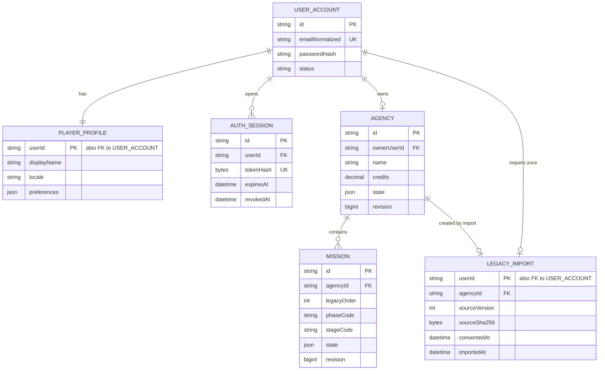

# t4 — MySQL Persistence Schema and Consented v32 Import Design

## Summary

Use a new MySQL 8.4 LTS/InnoDB schema with relational account, agency, and mission ownership, plus versioned JSON for the deeply nested and evolving Go-No-Go mission/campus state. Treat relational columns as the queryable identity/lifecycle projection and validate every JSON aggregate at the API boundary. Persist no legacy data until the player has affirmatively requested import; an accepted import is atomic and one-time per account.

This is a design artifact, not an implementation. The existing backend has no database layer, so no schema scripts or database tests have been run.

## Data Model

### Tables

| Table | Purpose and important columns | Constraints and indexes |
|---|---|---|
| `user_accounts` | `id BINARY(16) PK`, `email_normalized VARCHAR(254)`, `password_hash VARCHAR(255)`, `status`, `created_at`, `updated_at` | Unique normalized email; only an Argon2id PHC hash is stored, never a password. Disable accounts rather than reusing their identifiers. |
| `player_profiles` | `user_id BINARY(16) PK/FK`, `display_name`, `locale`, `preferences_json JSON`, timestamps | One profile per account; locale constrained to `it`/`en`. Preference JSON is schema-validated by the backend. |
| `auth_sessions` | `id BINARY(16) PK`, `user_id FK`, `token_hash BINARY(32)`, `expires_at`, `revoked_at`, timestamps | Unique token hash; index `(user_id, expires_at)` for revocation/expiry cleanup. Store only a digest of a high-entropy opaque session token. |
| `agencies` | `id BINARY(16) PK`, `owner_user_id FK`, `name`, `credits DECIMAL(14,2)`, `xp`, `science_total`, `staff_count`, `difficulty`, `sandbox`, `tutorial_state`, `state_schema_version`, `state_json JSON`, `current_mission_id NULL`, `revision BIGINT UNSIGNED`, timestamps | `UNIQUE(owner_user_id)` for the legacy one-agency-per-save model; resource checks after legacy-range validation. Composite unique `(id, current_mission_id)` is not needed; ownership and selection are verified in the service transaction. |
| `missions` | `id BINARY(16) PK`, `agency_id FK`, `legacy_order NULL`, `name`, `phase_code`, `stage_code`, `status`, `state_schema_version`, `state_json JSON`, `revision BIGINT UNSIGNED`, `created_at`, `updated_at`, `closed_at NULL` | Index `(agency_id, status, updated_at)` for profile lists; `UNIQUE(agency_id, legacy_order)` where non-null to retain imported order; composite `UNIQUE(agency_id, id)` supports ownership-scoped reads. Mission delete/update is always agency-scoped. |
| `legacy_imports` | `user_id BINARY(16) PK/FK`, `idempotency_key BINARY(16)`, `source_version`, `source_sha256 BINARY(32)`, `consent_copy_version`, `consented_at`, `imported_at`, `agency_id FK`, `mission_count` | Unique idempotency key; one row per user enforces one successful import per account. Store no password, localStorage key, or duplicate raw payload here. |
| `schema_migrations` | `version VARCHAR(64) PK`, `checksum BINARY(32)`, `applied_at` | Migration runner metadata; refuse to run if an applied migration's checksum changes. |

Use InnoDB, `utf8mb4`, UTC `DATETIME(3)`, and parameterized DAO queries. Generate UUIDs in the backend and map API UUID strings to/from `BINARY(16)` at the DAO boundary. Email canonicalization and normalization must be consistent between registration and login; enforce uniqueness on the normalized value.

### Aggregate and Relationship Boundaries

- One `user_account` owns one `player_profile`, one `agency`, and zero or more `auth_sessions`.
- One `agency` owns zero or more `missions`; every read/write query scopes the mission by both `mission_id` and its owning `agency_id` derived from the authenticated user.
- `agencies.state_json` contains versioned non-mission game state that has not yet earned stable relational columns, including campus/facility placements, recruitment/unlock collections, simulation settings, and forward-compatible extension data.
- `missions.state_json` contains the validated mission aggregate: stakeholder/support state, requirements and review decisions, satellite configuration/placements, flight/orbit plan and burns, test results/defects, operations events/choices, and report facts. `phase_code`, `stage_code`, and `status` are queryable projections and must be updated atomically with the JSON aggregate.
- JSON is a compatibility boundary, not a way to skip validation: `state_schema_version` selects a strict backend DTO/schema; reject invalid or oversized state, and never trust client-provided ownership, financial projections, or report outcomes. Compute protected projections server-side.
- Use `revision` as an optimistic concurrency token. Update an aggregate with `WHERE id = ? AND owner/agency = ? AND revision = ?`; increment on success and return a conflict on stale writes.
- Keep reference catalogs (parts, stakeholders, test classes, launch providers) in code/config unless they become independently administered data. Persist stable catalog keys in the validated JSON; do not make user-save imports depend on a particular catalog row set.

<!-- mermaid-checked: every attribute is `<type> <name> [<key>] ["<description>"]` with at most one of PK/FK/UK, no \n in descriptions, no {} in descriptions, every relationship label is double-quoted -->


## Legacy v32 Field Mapping

Source is the browser value at `localStorage['gng32.save']`; the legacy reader accepts only parsed objects with `v === 32`. The key stays local and is never deleted or changed by import.

| v32 source | Target | Mapping/preservation rule |
|---|---|---|
| `v` | `legacy_imports.source_version` | Require exactly `32`; do not infer support from other versions. |
| `co` | `agencies.name` | Validate non-empty name and the target length before any write. |
| `money`, `xp`, `sciTotal`, `staff` | `agencies.credits`, `xp`, `science_total`, `staff_count` | Validate numeric type, finiteness, and supported bounds; never silently clamp or round. Preserve the original value or reject with an actionable validation error. |
| `missions[]` | `missions` rows, in array order | Generate target UUIDs, store `legacy_order`, map every mission, and preserve the complete validated mission-specific state in versioned `state_json`. Do not skip a malformed mission. |
| `cur` | `agencies.current_mission_id` | Resolve from the original mission index to the newly generated mission UUID. Validate the index; an invalid non-empty selection is a recoverable import error, not a silent fallback. |
| Other root-level fields (`world`, `rooms`, `labPos`, `plots`, `pad`, `lab`, `recruited`, `myBoard`, tutorial/difficulty/clock fields, and future keys) | `agencies.state_json` | Preserve all non-mission members, including currently unknown keys, in a validated versioned extension object. |
| Remaining mission members (including mission-specific unknown keys) | `missions.state_json` | Preserve every source member not projected into identity/lifecycle columns; do not drop unsupported optional fields without an explicit error/report. |
| Source JSON bytes | `legacy_imports.source_sha256` | Hash a canonicalized parsed document for deduplication; do not store a second copy of the complete save in the import ledger. |

The mapper must use a pinned v32 DTO/schema grounded in the source, not a generic `JSON.parse` plus cast. Validate maximum request size/depth/counts from real v32 fixtures, required root/mission shapes, finite numbers, dates/timestamps, and known enum-like values. Unknown JSON members are retained in the extension documents. Reject unsafe keys/prototype-pollution patterns and never render imported strings as HTML.

## Consent-Gated Import Contract

### User-visible and request sequence

1. Provide an always-visible **Import legacy browser save** action in the profile/onboarding UI; do not probe `localStorage` to determine whether a save exists before consent.
2. Before any access to `localStorage['gng32.save']`, explain that the complete version-32 game save (agency, missions, campus state, progress/settings) will be read and sent to the authenticated account. Require an affirmative, deliberate action. Decline/cancel means no storage read, no import request, and no server write.
3. Only after consent, read and parse the key. If absent, corrupt, unsupported, or invalid, show a clear recovery choice; do not remove, overwrite, rewrite, or auto-reset the source key.
4. Submit the validated save over HTTPS to an authenticated import operation with `consent: true`, a stable consent-copy version, and an `Idempotency-Key`. The exact route/path belongs to the API-contract task; this design specifies its payload and transaction behavior.
5. Backend revalidates the full v32 DTO and recomputes the canonical SHA-256 digest. It does not trust a client digest, account ID, agency ID, resource total, or derived report.
6. In one InnoDB transaction, lock the authenticated account row; return the prior result for a completed identical import; reject a changed source after a completed import; reject importing over any existing non-empty account game; otherwise create the agency, all missions and their state, resolve `cur`, and insert the one-time `legacy_imports` consent/success record. Commit all or none.
7. A retry after rollback is safe. Concurrent submissions serialize on the user row/unique keys. Same successful digest is idempotent; another save after success returns a conflict requiring an explicit user decision rather than replacing cloud data. Reject import if the account already has an agency/game state; do not overwrite even an apparently empty cloud agency.
8. On success, report counts and the resulting agency/mission IDs. Leave the local key byte-for-byte unchanged. Offer deletion only as a separate, explicit local action after successful import; never delete automatically.

### Request/response DTO intent

```text
LegacyV32ImportRequest {
  consent: true,
  consentCopyVersion: "gng32-import-v1",
  sourceVersion: 32,
  save: LegacySaveV32
}
```

Send the retry key in the `Idempotency-Key` header (a UUID); the body `sourceVersion` must match `save.v`. Authentication supplies `userId`; it is never accepted from the request body. Server consent evidence is recorded only after the affirmative import request succeeds: `consented_at`, `consent_copy_version`, source version, digest, import time, resulting agency, and mission count. Do not retain IP/user-agent or the complete payload in the ledger absent a separate approved need. Never log the body, password hash, or raw session token.

Expected outcomes: `401` unauthenticated; `400` malformed transport or absent consent; `422` unsupported version, invalid nested save, or data that cannot be mapped faithfully; `409` account already has agency/game state, import already completed for another digest, or idempotency-key reuse with a different payload; `413` configured body limit exceeded; success returns the committed result (or the same result for an identical replay). Keep detailed parser errors safe and useful without reflecting untrusted input.

### Failure and preservation invariants

- No client-side read before affirmative consent; no request and no DB writes when declined.
- No writes before the transaction can atomically create the complete import; no partial agency/mission set or success ledger.
- Any validation/authorization/conflict/database failure leaves the original browser value unchanged and retryable.
- Existing cloud state is never replaced by import. Account/agency ownership is enforced on every query and write.
- If an import unexpectedly fails after DB commit but before the browser receives its response, replay with the same key/digest returns the committed result without duplicates.
- Reset/delete of the local save is not part of this importer.

## Migration and Operational Notes

- Create a new schema/database name from environment configuration; no legacy SQL database is present. Use separate least-privilege runtime and migration credentials. No real credentials belong in source control.
- Start with a forward-only initial migration for account/profile/session, agency/mission, and import tables. Use an application-managed versioned migration runner that serializes concurrent runners (e.g. a MySQL named lock), verifies checksums, and records completion only after postcondition checks.
- MySQL DDL implicitly commits; do not claim a multi-statement DDL migration is transactionally rollbackable. Make each migration safe to resume after partial DDL (check object/column/index existence and verify definitions), then test fresh install, interrupted/re-run, and repeated invocation. Keep data migrations separate from schema DDL.
- Future changes use expand/contract migrations; do not drop or narrow persisted fields without an explicit compatibility plan and backup/restore test. The initial schema has no destructive migration.
- Use UTC timestamps and a single DB connection/transaction for each aggregate save/import. Configure connection limits/timeouts and readiness checks in the backend/deployment configuration; secrets are environment-provided.
- Deletion semantics: revoke sessions immediately. Account/game deletion, if implemented, is explicit and ordered; do not use cascading deletes that can bypass an intentional user confirmation or break current-mission references.

## DAO/DTO Boundaries for Backend Handoff

- Route/controller validates authenticated identity and parses request DTOs; it does not issue SQL or serialize database rows directly.
- A `LegacyV32ImportMapper` converts a fully validated v32 DTO into agency/mission domain aggregates and preserves extension fields. It performs no database I/O.
- `AgencyDao`, `MissionDao`, `AuthSessionDao`, and `LegacyImportDao` expose typed operations and parameterized queries. `LegacyImportService` owns the transaction, ownership scoping, revision checks, idempotency, and unique-import rules.
- API DTOs expose only safe account/profile/mission fields, never password hashes, token digests, raw DB rows, or internal JSON not covered by the public game-state contract. Frontend cannot submit ownership IDs or authoritative resource/report totals.
- Backend should align its entity/query model with these table names and aggregate boundaries before implementation. Auth credential policy remains in the security/backend design; this schema stores a password hash and session-token digest only.

## Data Classification

| Data | Classification | Minimum controls |
|---|---|---|
| Email, display name | PII | Normalized unique login email; TLS in transit; account-scoped reads; no email in routine logs. |
| Password hash, session-token digest | Sensitive authentication material | Argon2id hash only; high-entropy random cookie token with only SHA-256 digest stored; Secure, HttpOnly, SameSite cookie; expiry/revocation; least privilege; never log/return. |
| Agency, mission, preferences, imported legacy state | Personal game/account data; generally not PII by itself | TLS; owner authorization; no public access; controlled backups; documented retention/deletion. Imported payload must not be used for HTML rendering without context-appropriate escaping. |
| Payment/health data | None in the current game model | Do not add without a separate product/security review. |

## Test/Acceptance Matrix for Implementation

| Test | Required outcome |
|---|---|
| Decline/cancel and pre-consent instrumentation | No localStorage read, import API request, consent row, or game-state write; original key unchanged. |
| No key, malformed JSON, unsupported version, malformed nested mission | Clear recovery response; zero partial DB writes; source unchanged. |
| Valid v32 save with multiple missions and non-default `cur` | One agency, every mission in order, selection mapped to the correct UUID, all root/mission extension data retained, one consent/import row. |
| Identical retry after success (same and new request key) | Same successful result, no duplicate agency/missions or extra import row. |
| Different source after successful import / existing cloud state | Conflict; original cloud and browser state unchanged. |
| Fault injection between aggregate inserts and import ledger | Transaction rollback leaves no agency, mission, or success record; same source can retry successfully. |
| Concurrent same-account import | At most one committed agency/import; all missions appear once; loser receives a replay/conflict result. |
| Cross-account mission read/update | Denied/not found; no owner data leak or mutation. |
| Migration install/re-run/interrupted recovery | Schema remains correct and existing rows remain intact; checksum drift fails closed. |
| Stale aggregate revision | Second writer receives conflict; no silent lost update. |

## Upstream Artifacts Consumed

- `.github/modernize/rearchitecture/clarification.md` — approved MySQL/new-schema, email/password, API-backed state, Italian/English, and consent-only import scope.
- `.github/modernize/rearchitecture/clarification-answers.md` — submitted B3/B4 decision detail and consent-selected import strategy.
- `.github/modernize/rearchitecture/artifacts/t1-pm.md` — `INV-02`, `INV-12`, `INV-13`, `REQ-003`, `REQ-018`–`REQ-020`, `SC-005` and `SC-006` define gameplay continuity, identity, and import acceptance.
- `.github/modernize/rearchitecture/artifacts/t2-architect.md` — current backend is health-only; save storage is localStorage key `gng32.save`; no DB or API persistence exists.
- `.github/modernize/rearchitecture/artifacts/t2.1-architect.md` — persistence/import mitigation contract requires full validation, affirmative consent, idempotency, non-destructive failures, and import retry tests.
- `.github/modernize/rearchitecture/artifacts/t3-architect.md` — API conventions and importer behavior specify the authenticated v1 DTO boundary, `Idempotency-Key`, ownership rules, and `422` for valid-but-unmappable legacy data.
- `.github/modernize/rearchitecture/artifacts/data-model.md` — observed legacy root fields, mission-array/current-index relationship, and version-32 load behavior.
- `.github/modernize/rearchitecture/decisions.md` — retain `Go-No-Go.html` as behavioral reference only; user-approved in-place rewrite.
- `.github/modernize/rearchitecture/team/dba/inbox.md` — prior architecture notes reinforcing the reference-only iframe cut and import preservation gates.

## Evidence Mapping

- `t1-pm.md#INV-13`, `#REQ-019`–`#REQ-020`, `#SC-005`–`#SC-006` → account-owned agency/mission rows, session/profile tables, one-time import ledger, and explicit import test matrix.
- `t2-architect.md#Key Risk Evidence` and `data-model.md#Root game-state fields observed` → source-to-target mapping and JSON extension strategy preserve legacy state without treating key presence as validity.
- `t2.1-architect.md#Persistence/import cutover` → consent-before-read, strict v32 validation, atomic transaction, idempotent retry, no cloud overwrite, and original-save preservation invariants.
- `t3-architect.md#API conventions` and `#Legacy v32 import protocol` → header-based idempotency, authenticated import DTO, all-or-nothing mapping, and `422` for unfaithful mappings.
- `clarification.md#Backend` and `clarification-answers.md#B3` → new MySQL schema, account identity and consent-only browser-save import.

## Test Results

- Command: none (design-only task; no schema/code was modified).
- Passed: not applicable.
- Failed: 0.
- Skipped: implementation integration tests remain a required downstream gate; matrix above defines expected coverage.

## References

- MySQL 8.4 Reference Manual, JSON Data Type: <https://dev.mysql.com/doc/mysql/en/json.html> — native JSON validates stored documents.
- MySQL 8.4 Reference Manual, Statements That Cause an Implicit Commit: <https://dev.mysql.com/doc/refman/8.4/en/implicit-commit.html> — DDL cannot be treated as transactionally rollbackable.
- MySQL 8.4 Reference Manual, Locking Functions: <https://dev.mysql.com/doc/refman/8.4/en/locking-functions.html> — `GET_LOCK()` lock lifetime and release behavior.
