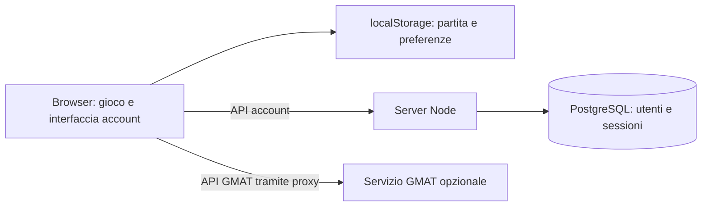

[English](README.md) | **Italiano**

<div align="center">

# 🚀 GO / NO-GO
### Space Mission Design Game

**Dall'idea al lancio: progetta una missione, costruisci il tuo CubeSat e dimostra che può funzionare.**

Campus e laboratori 3D · Progettazione orbitale · Gestione delle risorse · Analisi NASA GMAT · Account PostgreSQL

[Inizia subito](#avvio-rapido) · [Come funziona il database](documentation/authentication.it.md) · [Documentazione](documentation/README.md) · [Distribuzione Azure](documentation/deployment.it.md)

</div>

---

## Il progetto

**Go No-Go** è un gioco web educativo sulla progettazione di missioni spaziali. Gestisci un'agenzia, negozi gli obiettivi con gli stakeholder, scegli strumenti e sottosistemi, assembli un satellite, pianifichi l'orbita e affronti revisioni, test e lancio. Ogni scelta cambia il bilancio di massa, energia, costo, dati e valore scientifico.

Il progetto usa **Node.js 24+, Vite, JavaScript, Three.js e PostgreSQL**. Il gioco e le sue simulazioni immediate girano nel browser. Un server Node serve gli asset e gestisce gli account; un servizio separato, opzionale, esegue NASA GMAT R2025a per approfondire i calcoli orbitali.

> **Account e partite sono due cose diverse:** PostgreSQL conserva utenti e sessioni. La partita viene salvata nel `localStorage` del browser. Accedere da un altro dispositivo non recupera la missione.

Questa documentazione descrive il codice presente nel repository; non certifica lo stato di un ambiente Azure o di un workflow remoto.

## Indice

- [Esperienza di gioco](#esperienza-di-gioco)
- [Avvio rapido](#avvio-rapido)
- [Avvio completo con account](#avvio-completo-con-account)
- [NASA GMAT](#nasa-gmat)
- [Architettura e database](#architettura-e-database)
- [Comandi disponibili](#comandi-disponibili)
- [Struttura del repository](#struttura-del-repository)
- [Build e distribuzione](#build-e-distribuzione)
- [Qualità grafica e accessibilità](#qualità-grafica-e-accessibilità)
- [Verifiche e risoluzione dei problemi](#verifiche-e-risoluzione-dei-problemi)
- [Guide di approfondimento](#guide-di-approfondimento)

## Esperienza di gioco

| Fase | Cosa fai | Cosa impari |
| --- | --- | --- |
| Agenzia e campus | Organizzi strutture, personale e sviluppo | Risorse e infrastrutture condizionano le missioni |
| Obiettivi e requisiti | Confronti priorità e aspettative degli stakeholder | I requisiti devono essere compatibili tra loro |
| Progettazione | Configuri struttura, payload e sottosistemi | Massa, potenza, dati e costo sono interdipendenti |
| Orbita e lanciatore | Definisci destinazione, trasferimenti e lancio | Il budget di ΔV e la capacità del lanciatore limitano il progetto |
| Revisioni e test | Verifichi il progetto e affronti prove e minigiochi | I problemi devono emergere prima del volo |
| Missione e rapporto | Valuti operazioni, risultati e fine vita | Il successo dipende dall'intero sistema |

Sono presenti tutorial e modalità sandbox. L'interfaccia del gioco supporta italiano e inglese; le guide del repository sono disponibili in italiano e in inglese. La richiesta della challenge di cooperazione fino a quattro persone è un obiettivo progettuale: non è presente un backend multiplayer o una classifica condivisa.

## Avvio rapido

Prerequisiti: **Node.js 24 o successivo**, npm e Git. La versione di riferimento è indicata in `.nvmrc`. Docker Desktop è necessario per PostgreSQL locale e per GMAT, ma il gioco può funzionare senza questi servizi.

```powershell
git clone https://github.com/NASA-SPACEAPP-2026/Space-Mission-Design-Game.git
cd Space-Mission-Design-Game
npm ci
npm run dev
```

Apri l'indirizzo stampato da Vite, normalmente **http://localhost:5173**. In PowerShell, se l'esecuzione di `npm.ps1` è bloccata, usa `npm.cmd` al posto di `npm`.

Questa modalità permette di giocare come ospite. Senza backend le chiamate account inoltrate da Vite non riescono; il backend avviato senza configurazione DB risponde invece `503` alle API account.

`npm run dev` esegue prima `scripts/gmat-up.mjs`: tenta di avviare GMAT e prosegue anche se Docker o il servizio non sono disponibili. Leggi la nota sui due file Compose nella sezione GMAT.

## Avvio completo con account

Esegui dalla radice del repository, con Docker Desktop attivo:

```powershell
npm ci
docker compose -f compose.yaml up -d --wait postgres
Copy-Item .env.example .env
npm run db:migrate
npm run dev:api
```

Copia `.env.example` solo se non hai già un `.env` da conservare. Lascia il backend aperto e, in un **secondo terminale**, esegui:

```powershell
npm run dev
```

Apri **http://localhost:5173**, quindi il pulsante **Account**. Puoi registrarti e accedere con username oppure email. Vite inoltra `/api/auth/*` al backend sulla porta 8080.

| Variabile | Sviluppo locale | Funzione |
| --- | --- | --- |
| `DATABASE_URL` | Valore di `.env.example` | Connessione PostgreSQL locale, database `gng` |
| `DATABASE_SSL` | `false` | Disabilita TLS solo per il database locale |
| `APP_ORIGIN` | `http://localhost:5173` | Origine esatta ammessa per i POST account |
| `NODE_ENV` | `development` | Consente HTTP e cookie senza `Secure` in locale |
| `PORT` | `8080` se non impostata | Porta del server Node |

Le credenziali di esempio sono esclusivamente di sviluppo. `dev:api` e `db:migrate` caricano `.env`; **`npm start` non lo carica automaticamente**.

Per fermare PostgreSQL conservando gli account:

```powershell
docker compose -f compose.yaml stop postgres
```

Il volume `postgres-data` mantiene i dati. `docker compose -f compose.yaml down -v` elimina anche il volume: non usarlo se vuoi conservarli.

## NASA GMAT

Il gioco calcola subito le proprie stime e può chiedere a **NASA GMAT R2025a** ulteriori risultati per Terra, Luna, Marte e Venere:

- ΔV dei trasferimenti;
- eclissi e contatti con stazioni a terra;
- evoluzione dell'orbita e deriva nodale;
- durata orbitale e scenari di fine vita.

I risultati vengono mostrati nell'analisi orbitale, nei bilanci, nelle revisioni e nei rapporti, con indicazione della fonte. Se GMAT non è disponibile, rimane il modello interno.

**Attenzione ai file Compose:** `compose.yaml` definisce PostgreSQL, mentre `docker-compose.yml` definisce GMAT. L'avvio automatico usa `docker compose` senza `-f`: con entrambi i file presenti la selezione predefinita può escludere GMAT. Per un avvio riproducibile usa entrambi esplicitamente:

```powershell
docker compose -f compose.yaml -f docker-compose.yml up -d --build gmat
```

La base locale richiesta è `smdg-gmat-base:r2025a`. Lo script automatico tenta prima di scaricarla da GHCR, poi di costruirla; il primo download GMAT è di circa 420 MB. Se la base manca, trovi i comandi manuali nella [guida GMAT](documentation/gmat-integration-report.it.md).

Dopo modifiche ai file montati `scripts/gmat-*.mjs` o `public/game/02-orbit.js`:

```powershell
docker compose -f compose.yaml -f docker-compose.yml restart gmat
```

Vite inoltra `/api/gmat*` alla porta **8787**. Il server di produzione `server.mjs` non contiene questo proxy: pubblicare soltanto il pacchetto Azure non rende GMAT disponibile online.

## Architettura e database



In sviluppo il proxy è Vite. In produzione occorre configurare separatamente l'instradamento verso GMAT.

**Il database oggi contiene tre tabelle:**

| Tabella | Contenuto | Scopo |
| --- | --- | --- |
| `users` | UUID, username, email, hash password, data di creazione | Identità dell'utente |
| `sessions` | Hash del token, utente, scadenza | Accessi persistenti per sette giorni |
| `auth_limits` | Chiave hash, contatore, scadenza | Limiti condivisi ai tentativi di accesso e registrazione |

La password viene trasformata con **scrypt e sale casuale**. Il browser riceve un cookie `gng_session` con un token casuale; nel DB viene salvato solo l'hash SHA-256 del token. In produzione il cookie usa `HttpOnly`, `Secure` e `SameSite=Lax`.

Non esistono tabelle per missioni, satelliti o inventario. La chiave `gng32.save` nel browser conserva lo stato di gioco. Due account sullo stesso profilo browser usano lo stesso salvataggio; il logout non lo cancella.

Lo schema è in [`db/001-auth.sql`](db/001-auth.sql), applicato esplicitamente con `npm run db:migrate`. Non viene creato all'avvio del server. La [guida account e database](documentation/authentication.it.md) descrive schema, API, sicurezza, manutenzione e limiti.

## Comandi disponibili

| Comando | Risultato e prerequisiti |
| --- | --- |
| `npm ci` | Installa le versioni del lockfile |
| `npm run dev` | Tenta l'avvio GMAT, poi avvia Vite sulla porta 5173 |
| `npm run dev:api` | Backend sulla porta 8080, modalità watch, caricamento `.env` |
| `npm run db:migrate` | Applica lo schema account al DB configurato in `.env` o nell'ambiente |
| `npm test` | Suite Vitest: gioco, server, account e bridge GMAT |
| `npm run build` | Vite, bundle gioco con hash, compressione Brotli/gzip in `dist/` |
| `npm run preview` | Anteprima Vite sulla porta 4173; non avvia API o proxy account |
| `npm start` | Server Node su `dist/`; variabili da fornire nell'ambiente |
| `npm run check` | Test, build e verifica del risultato compilato |
| `npm run smoke` | Controllo browser del gioco; richiede server attivo e Chromium |
| `node scripts/smoke-account.mjs` | Controllo browser account con PGlite temporaneo e build esistente |
| `npm run package:azure` | Crea `release.zip` da build esistente; richiede Bash, zip e npm |
| `npm run package:single` | Compila e rigenera `dist/Go No-Go.html` |

## Struttura del repository

```text
index.html                    Struttura HTML e stili dell'interfaccia
public/
  account.js                  Interfaccia account indipendente dal gioco
  game/                       Motore, dati, renderer, interfacce e minigiochi
  fonts/                      Font WOFF2 e licenze OFL
  audio/theme.mp3              Colonna sonora caricata separatamente
backend/
  auth.mjs                    Registrazione, login, cookie e limiti
  database.mjs                Pool PostgreSQL e applicazione schema
db/001-auth.sql               Schema account
server.mjs                    Server asset, API account e sonda di processo
vite.config.ts                Build frontend e proxy di sviluppo
compose.yaml                  PostgreSQL 17 locale con volume persistente
docker-compose.yml            Servizio GMAT su localhost:8787
docker/gmat/                  Immagine base e immagine applicativa GMAT
scripts/                      Build, migrazione, GMAT, pacchetti e smoke test
tests/                        Test automatici
infra/                        Provisioning e rimozione risorse Azure
.github/workflows/            CI/CD e pubblicazione immagine base GMAT
documentation/                Guide tecniche in italiano
dist/Go No-Go.html            Esportazione generata, da rigenerare dai sorgenti
```

I file in `public/game/` sono script classici con dipendenze nell'ordine di caricamento: non sono ancora moduli ES indipendenti. La [guida architetturale](documentation/architecture.it.md) dettaglia l'ordine effettivo.

## Build e distribuzione

Per provare la build con gli account e caricare anche `.env`:

```powershell
npm run build
# Per questa prova diretta, imposta APP_ORIGIN=http://localhost:8080 nel .env.
node --env-file-if-exists=.env server.mjs
```

Apri **http://localhost:8080**. Ripristina `APP_ORIGIN=http://localhost:5173` prima di tornare allo sviluppo con Vite. `APP_ORIGIN` deve coincidere con l'origine visitata, senza slash finale: `localhost` e `127.0.0.1` sono origini diverse.

La CI esegue controlli e packaging per PR verso `dev` e `main`. Un push su `dev` distribuisce in **staging**, un push su `main` in **produzione**. In produzione il server richiede DB e origine HTTPS; le migrazioni vanno applicate prima del deploy. Consulta la [guida Azure](documentation/deployment.it.md).

### Esportazione HTML

```powershell
npm run package:single
# Dopo la build, per una cartella trasportabile con audio:
node scripts/build-single-file.mjs --bundle out/
```

L'esportazione incorpora il bundle del gioco, i font locali e l'icona. L'audio resta separato. Non incorpora Node, PostgreSQL o GMAT; lo script segnala eventuali percorsi assoluti residui. Non considerarla un pacchetto autonomo delle funzioni account: dipendenze remote e comportamento `file://` richiedono una verifica dedicata.

## Qualità grafica e accessibilità

Il campus 3D include illuminazione, ombre e animazioni. Un regolatore adatta qualità e rapporto pixel alle prestazioni del dispositivo; il livello viene conservato in `gngQ`.

| Parametro URL | Uso |
| --- | --- |
| `?perf=1` | Mostra indicatori di prestazioni |
| `?q=0` … `?q=3` | Forza il livello grafico; 3 è il più alto |
| `?mob=1` | Attiva percorsi mobili anche sul desktop |

Il codice considera `prefers-reduced-motion`. Le viste 3D dipendono da WebGL; sono presenti percorsi alternativi, ma non va presunta la parità di tutte le viste su ogni dispositivo. Oltre ai font locali, la pagina richiede famiglie a Google Fonts.

## Verifiche e risoluzione dei problemi

```powershell
npm run check
```

I test account usano **PGlite temporaneo**, senza richiedere il DB Docker né usare account reali. Le prove GMAT includono generatori, parser e un eseguibile simulato: superarle non equivale a eseguire il vero GMAT nel container.

| Sintomo | Controllo |
| --- | --- |
| Account non disponibili | Backend attivo, `DATABASE_URL` corretta, PostgreSQL avviato, migrazione applicata |
| `403` agli account | `APP_ORIGIN` uguale a protocollo, host e porta del browser |
| `503` agli account | Distinguere DB non configurato da DB/schema irraggiungibile; consultare log backend |
| GMAT non si avvia | Docker attivo, immagine base disponibile e file Compose espliciti |
| GMAT assente in Azure | Il pacchetto applicativo non ospita né inoltra il servizio GMAT |
| Partita assente dopo il login | Verificare browser, profilo e origine: non esiste salvataggio cloud |
| `npm start` ignora `.env` | Usare variabili di ambiente o il comando Node con `--env-file-if-exists` |
| Smoke test senza browser | Impostare `CHROME_PATH` al percorso dell'eseguibile Chromium/Chrome |

Per gli smoke test e i controlli manuali consulta la [guida alle verifiche](documentation/testing.it.md).

## Guide di approfondimento

| Guida | Contenuto |
| --- | --- |
| [Indice documentazione](documentation/README.md) | Percorsi di lettura e fonti nel codice |
| [Architettura](documentation/architecture.it.md) | Componenti, renderer, flussi e build |
| [Account e database](documentation/authentication.it.md) | Schema PostgreSQL, sessioni, API e gestione operativa |
| [Salvataggi locali](documentation/legacy-save-format.it.md) | Formato v32, preferenze, backup e compatibilità |
| [GMAT](documentation/gmat-integration-report.it.md) | Avvio, API, modelli fisici e limiti |
| [Distribuzione](documentation/deployment.it.md) | Azure, CI/CD, configurazione e rollback |
| [Verifiche](documentation/testing.it.md) | Test automatici, smoke test e checklist manuale |
| [Challenge](documentation/challenge.it.md) | Obiettivi educativi e distinzione dalle funzioni implementate |

La versione inglese completa è disponibile in [`README.md`](README.md).
