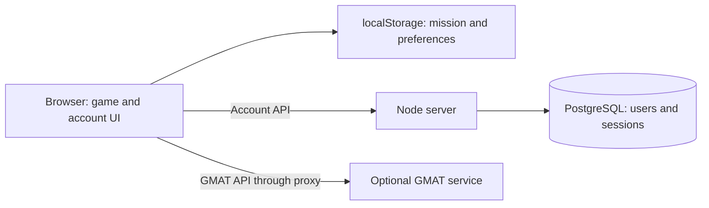

**English** | [Italiano](README.it.md)

<div align="center">

# 🚀 GO / NO-GO
### Space Mission Design Game

**From idea to launch: design a mission, build your CubeSat, and prove it can work.**

3D campus and labs · Orbital design · Resource management · NASA GMAT analysis · PostgreSQL accounts

[Get started](#quick-start) · [How the database works](documentation/authentication.md) · [Documentation](documentation/README.md) · [Azure deployment](documentation/deployment.md)

</div>

---

## The project

**Go No-Go** is an educational web game about space mission design. Run an agency, negotiate goals with stakeholders, select instruments and subsystems, assemble a satellite, plan its orbit, and work through reviews, tests, and launch. Each decision affects mass, energy, cost, data, and scientific value.

The project uses **Node.js 24+, Vite, JavaScript, Three.js, and PostgreSQL**. Gameplay and immediate simulation run in the browser. A Node server serves assets and manages accounts; a separate optional service runs NASA GMAT R2025a for more detailed orbital calculations.

> **Accounts and saved games are separate:** PostgreSQL stores users and sessions. Missions are saved in browser `localStorage`. Signing in on another device does not retrieve your mission.

These documents describe the repository implementation; they do not certify the state of any Azure environment or remote workflow.

## Contents

- [Gameplay](#gameplay)
- [Quick start](#quick-start)
- [Full setup with accounts](#full-setup-with-accounts)
- [NASA GMAT](#nasa-gmat)
- [Architecture and database](#architecture-and-database)
- [Available commands](#available-commands)
- [Repository layout](#repository-layout)
- [Build and deployment](#build-and-deployment)
- [Graphics and accessibility](#graphics-and-accessibility)
- [Checks and troubleshooting](#checks-and-troubleshooting)
- [Further reading](#further-reading)

## Gameplay

| Stage | What you do | What you learn |
| --- | --- | --- |
| Agency and campus | Organize facilities, staff, and development | Resources and infrastructure constrain missions |
| Goals and requirements | Compare stakeholder priorities | Requirements must work together |
| Design | Configure structure, payload, and subsystems | Mass, power, data, and cost are interconnected |
| Orbit and launcher | Choose destination, transfers, and launch | ΔV and launcher capacity constrain the design |
| Reviews and tests | Check the design and complete tests and minigames | Problems should surface before flight |
| Mission and report | Assess operations, outcomes, and end of life | Success depends on the whole system |

Tutorial and sandbox modes are available. The game supports Italian and English, as do the repository guides. Cooperation for up to four people is an objective from the challenge brief: there is currently no multiplayer backend or shared leaderboard.

## Quick start

Requirements: **Node.js 24 or newer**, npm, and Git. `.nvmrc` identifies the reference version. Docker Desktop is needed for local PostgreSQL and GMAT, but gameplay can run without either service.

```powershell
git clone https://github.com/NASA-SPACEAPP-2026/Space-Mission-Design-Game.git
cd Space-Mission-Design-Game
npm ci
npm run dev
```

Open the address printed by Vite, normally **http://localhost:5173**. In PowerShell, use `npm.cmd` instead of `npm` if script execution policy blocks `npm.ps1`.

This setup supports guest gameplay. Without the backend, Vite's proxied account requests fail; a backend started without DB configuration instead returns `503` for account APIs.

`npm run dev` first runs `scripts/gmat-up.mjs`. It attempts to start GMAT and continues even if Docker or the service is unavailable. Read the two-file Compose caveat below.

## Full setup with accounts

From the repository root, with Docker Desktop running:

```powershell
npm ci
docker compose -f compose.yaml up -d --wait postgres
Copy-Item .env.example .env
npm run db:migrate
npm run dev:api
```

Copy `.env.example` only if you do not already have a `.env` to preserve. Leave the API terminal running and start this in a **second terminal**:

```powershell
npm run dev
```

Open **http://localhost:5173**, then **Account**. Register or sign in with a username or email address. Vite forwards `/api/auth/*` to the backend on port 8080.

| Variable | Local development | Purpose |
| --- | --- | --- |
| `DATABASE_URL` | Value from `.env.example` | Local PostgreSQL connection to database `gng` |
| `DATABASE_SSL` | `false` | Disable TLS for the local DB only |
| `APP_ORIGIN` | `http://localhost:5173` | Exact allowed origin for account POST requests |
| `NODE_ENV` | `development` | Allow local HTTP and cookies without `Secure` |
| `PORT` | Defaults to `8080` | Node server port |

Example credentials are for development only. `dev:api` and `db:migrate` load `.env`; **`npm start` does not load it automatically**.

Stop PostgreSQL while keeping accounts:

```powershell
docker compose -f compose.yaml stop postgres
```

The `postgres-data` volume persists data. `docker compose -f compose.yaml down -v` also removes that volume: do not use it if you want to retain local accounts.

## NASA GMAT

The game produces immediate estimates and can request more detailed results from **NASA GMAT R2025a** for Earth, the Moon, Mars, and Venus:

- transfer ΔV;
- eclipses and ground-station contacts;
- orbital evolution and nodal drift;
- orbital lifetime and end-of-life scenarios.

Results appear in orbital analysis, budgets, reviews, and reports, with their source identified. When GMAT is unavailable, the internal model remains in use.

**Compose file caveat:** `compose.yaml` defines PostgreSQL, while `docker-compose.yml` defines GMAT. The automatic startup calls `docker compose` without `-f`; with both files present, default selection can exclude GMAT. For predictable startup, select both explicitly:

```powershell
docker compose -f compose.yaml -f docker-compose.yml up -d --build gmat
```

The required local base image is `smdg-gmat-base:r2025a`. Automatic startup tries GHCR first, then a local build; the first NASA download is approximately 420 MB. If the base image is missing, use the manual commands in the [GMAT guide](documentation/gmat-integration-report.md).

After editing mounted `scripts/gmat-*.mjs` files or `public/game/02-orbit.js`:

```powershell
docker compose -f compose.yaml -f docker-compose.yml restart gmat
```

Vite forwards `/api/gmat*` to port **8787**. Production `server.mjs` does not implement this proxy: deploying the Azure web package alone does not make GMAT available online.

## Architecture and database



Vite supplies the development proxy. Production routing to GMAT must be configured separately.

**The database currently has three tables:**

| Table | Contents | Purpose |
| --- | --- | --- |
| `users` | UUID, username, email, password hash, creation time | User identity |
| `sessions` | Token hash, user, expiry | Persistent sign-in lasting seven days |
| `auth_limits` | Hashed key, counter, expiry | Shared login and registration limits |

Passwords are processed with **scrypt and a random salt**. The browser receives a random token in the `gng_session` cookie; PostgreSQL stores only its SHA-256 hash. Production cookies use `HttpOnly`, `Secure`, and `SameSite=Lax`.

There are no tables for missions, satellites, or inventory. Browser key `gng32.save` holds game state. Two accounts using the same browser profile share that saved game; logout does not delete it.

The schema is in [`db/001-auth.sql`](db/001-auth.sql), explicitly applied with `npm run db:migrate`. Server startup does not create it. The [account and database guide](documentation/authentication.md) covers schema, APIs, security, maintenance, and limitations.

## Available commands

| Command | Result and prerequisites |
| --- | --- |
| `npm ci` | Install the versions recorded in the lockfile |
| `npm run dev` | Attempt GMAT startup, then start Vite on port 5173 |
| `npm run dev:api` | Backend on port 8080, watch mode, loads `.env` |
| `npm run db:migrate` | Apply account schema to the DB configured by `.env` or the environment |
| `npm test` | Vitest suite for game, server, accounts, and GMAT bridge |
| `npm run build` | Vite build, hashed game bundle, Brotli/gzip files in `dist/` |
| `npm run preview` | Vite preview on port 4173; does not start account APIs or their proxy |
| `npm start` | Node server for `dist/`; supply environment variables separately |
| `npm run check` | Tests, production build, and build verification |
| `npm run smoke` | Browser gameplay smoke test; needs a running server and Chromium |
| `node scripts/smoke-account.mjs` | Browser account smoke with temporary PGlite and an existing build |
| `npm run package:azure` | Package existing build as `release.zip`; needs Bash, zip, and npm |
| `npm run package:single` | Build and regenerate `Go No-Go.html` |

## Repository layout

```text
index.html                    UI markup and styles
public/
  account.js                  Account UI independent of gameplay
  game/                       Data, logic, renderers, screens, and minigames
  fonts/                      WOFF2 fonts and OFL licenses
  audio/theme.mp3              Separately loaded soundtrack
backend/
  auth.mjs                    Registration, login, cookies, and limits
  database.mjs                PostgreSQL pool and schema application
db/001-auth.sql               Account schema
server.mjs                    Asset server, account APIs, and process probe
vite.config.ts                Frontend build and development proxy
compose.yaml                  Local PostgreSQL 17 with persistent volume
docker-compose.yml            GMAT service on localhost:8787
docker/gmat/                  GMAT base and application images
scripts/                      Build, migration, GMAT, packaging, and smoke tools
tests/                        Automated tests
infra/                        Azure provisioning and teardown
.github/workflows/            CI/CD and GMAT base image publishing
documentation/                English and Italian technical guides
Go No-Go.html                 Generated export; regenerate from source
```

Files under `public/game/` remain classic scripts with ordered dependencies; they are not independent ES modules. The [architecture guide](documentation/architecture.md) documents their actual order.

## Build and deployment

To try the production build with accounts while loading `.env`:

```powershell
npm run build
# For this direct test, set APP_ORIGIN=http://localhost:8080 in .env.
node --env-file-if-exists=.env server.mjs
```

Open **http://localhost:8080**. Restore `APP_ORIGIN=http://localhost:5173` before returning to Vite development. `APP_ORIGIN` must match the visited origin without a trailing slash: `localhost` and `127.0.0.1` are different origins.

CI checks and packages PRs targeting `dev` and `main`. Pushes to `dev` deploy to **staging**; pushes to `main` deploy to **production**. Production requires a DB and an HTTPS origin; apply migrations before deployment. See [Azure deployment](documentation/deployment.md).

### HTML export

```powershell
npm run package:single
# After building, create a portable folder including audio:
node scripts/build-single-file.mjs --bundle out/
```

The export embeds the game bundle, local fonts, and icon. Audio remains separate. It does not embed Node, PostgreSQL, or GMAT; the script reports remaining absolute paths. Do not treat it as a self-contained account application: remote dependencies and `file://` behavior need separate verification.

## Graphics and accessibility

The 3D campus includes lighting, shadows, and animation. A performance governor adjusts quality and pixel ratio to the device, storing the level in `gngQ`.

| URL parameter | Purpose |
| --- | --- |
| `?perf=1` | Show performance indicators |
| `?q=0` … `?q=3` | Force a quality level; 3 is highest |
| `?mob=1` | Enable mobile paths on desktop |

The code considers `prefers-reduced-motion`. 3D views require WebGL; alternative paths exist, but full parity across every view and device should not be assumed. Alongside local fonts, the page requests Google Fonts families.

## Checks and troubleshooting

```powershell
npm run check
```

Account tests use **temporary PGlite**, without the Docker database or real users. GMAT tests cover generators, parsers, and a simulated executable: passing them does not mean real GMAT has run in Docker.

| Symptom | Check |
| --- | --- |
| Accounts unavailable | Running backend, valid `DATABASE_URL`, PostgreSQL up, schema applied |
| Account `403` | `APP_ORIGIN` matches browser protocol, host, and port |
| Account `503` | Distinguish missing DB configuration from unreachable DB/schema; check backend logs |
| GMAT does not start | Docker running, base image available, explicit Compose files |
| No GMAT in Azure | Web package neither hosts nor proxies the separate GMAT service |
| Mission missing after login | Check browser, profile, and origin: there is no cloud save |
| `npm start` ignores `.env` | Supply environment variables or use Node with `--env-file-if-exists` |
| No browser for smoke tests | Set `CHROME_PATH` to the installed Chromium/Chrome executable |

See the [testing guide](documentation/testing.md) for browser smoke tests and manual checks.

## Further reading

| Guide | Contents |
| --- | --- |
| [Documentation index](documentation/README.md) | Reading paths and source-of-truth files |
| [Architecture](documentation/architecture.md) | Components, rendering, flows, and build |
| [Accounts and database](documentation/authentication.md) | PostgreSQL schema, sessions, API, and operations |
| [Local saves](documentation/legacy-save-format.md) | v32 format, preferences, backup, and compatibility |
| [GMAT](documentation/gmat-integration-report.md) | Startup, API, physical models, and limitations |
| [Deployment](documentation/deployment.md) | Azure, CI/CD, configuration, and rollback |
| [Testing](documentation/testing.md) | Automated tests, browser checks, and manual checklist |
| [Challenge](documentation/challenge.md) | Educational objectives versus implemented features |

The complete Italian version is available in [`README.it.md`](README.it.md).
