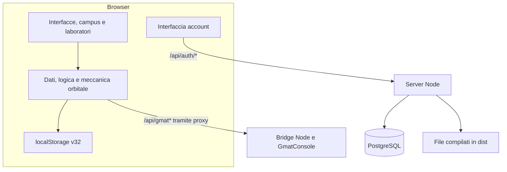

[English](architecture.md) | **Italiano**

# Architettura e flussi del progetto

[Indice](README.it.md) · [Database](authentication.it.md) · [GMAT](gmat-integration-report.it.md)

## Vista d'insieme

Go No-Go comprende tre componenti: un gioco eseguito nel browser, un backend Node per file e account, un servizio GMAT opzionale. Gli asset frontend sono compilabili e distribuibili come sito statico; le funzioni account richiedono Node e PostgreSQL.

Il server Node inoltra ora `/api/gmat`, `/api/gmat/analysis` e `/api/gmat/lifetime` al servizio configurato. In produzione usa `GMAT_URL`, oppure il valore di `gmat-service.json`; `GMAT_URL=off` disabilita il proxy. Senza servizio risponde `503 no-gmat`, con servizio irraggiungibile `502 gmat-unreachable`. Il container resta separato e non è incluso nello ZIP web.

## Frontend e ordine degli script

`index.html` contiene struttura e stili. Gli script del gioco sono **script classici**, con identificatori e dipendenze condivisi. L'ordine effettivo, usato anche dal compilatore del bundle, è:

| Ordine | File in `public/game/` | Responsabilità |
| --- | --- | --- |
| 1 | `00-three.js` | Libreria Three.js locale |
| 2 | `00-toon.js` | Stile e supporti grafici |
| 3 | `01-data.js` | Cataloghi e dati del gioco |
| 4 | `02-orbit.js` | Meccanica orbitale e calcoli |
| 5 | `03-logic.js` | Regole e simulazione di missione |
| 6 | `04-stubs.js` | Editor e visualizzazioni 3D, inclusi satellite e volo |
| 7 | `05-campus.js` | Campus e strutture |
| 8 | `06-rooms.js` | Ambienti e stanze |
| 9 | `08-minigames.js` | Minigiochi e prove |
| 10 | `07-main.js` | Avvio, stato, interfacce, salvataggio e integrazioni |

L'ordine non coincide con l'ordinamento alfabetico: `08-minigames.js` precede `07-main.js`. Una modifica deve mantenere coerenti HTML, `scripts/build-game.mjs` e test del contratto.

`public/account.js` viene caricato separatamente come modulo e gestisce il pulsante e il dialogo account. Non trasforma lo stato del gioco in dati associati all'utente.

## Rendering e risorse

Il progetto include campus e stanze 3D, editor del satellite e dell'orbita e viste SVG/2D. Three.js richiede WebGL. Il codice prevede controlli di disponibilità e viste alternative, ma la copertura dei fallback va verificata per la schermata interessata.

Un regolatore delle prestazioni modifica qualità e rapporto pixel, con preferenza salvata in `gngQ`. `?perf=1`, `?q=0..3` e `?mob=1` aiutano il collaudo. Le animazioni considerano `prefers-reduced-motion`.

I font locali si trovano in `public/fonts/`, con licenze OFL. La pagina richiede anche famiglie a Google Fonts: avere font locali non equivale a completa assenza di richieste esterne. `public/audio/theme.mp3` è caricato separatamente e non incorporato nel normale HTML.

Le texture Terra, Luna, Marte e Venere del Flight Dynamics Centre sono in `public/tex/`, copiate nella build. Le fonti sono in [Crediti immagini](../public/tex/CREDITS.it.md).

## Ingresso prima della simulazione

`index.html` mostra l’introduzione; `public/account.css` ne definisce lo stile. `public/account.js` controlla `/api/auth/me` e attende sempre il clic o l’attivazione da tastiera. Se serve, mostra registrazione/login con username e password. Solo dopo una sessione valida emette `gng-authenticated`: il listener del gioco chiama `start()` una sola volta, conserva il salvataggio e chiude il menu iniziale per entrare nel campus. Il primo avvio usa lo username come nome agenzia. Il logout revoca la sessione e ricarica la pagina.

Questa è una regola di ingresso dell’interfaccia, non una protezione degli asset statici. [Ingresso e account](entry-flow.it.md).

## Stato e persistenza

L'oggetto di gioco `G` viene creato da `newG()` e serializzato da `save()` nella chiave `gng32.save`. `load()` accetta soltanto oggetti con `v === 32`. Non c'è uno schema dichiarativo completo per le missioni né un migratore generale dei salvataggi.

Il backend conserva soltanto utenti, sessioni e limiti ai tentativi. Il servizio GMAT gestisce calcoli e cache separati dal database account. I risultati orbitali incorporati nella missione seguono il salvataggio locale della missione.

Consulta [formato dei salvataggi](legacy-save-format.it.md) e [schema PostgreSQL](authentication.it.md) per i due modelli distinti.

## Routing in sviluppo

| Percorso/porta | Destinazione |
| --- | --- |
| `localhost:5173` | Vite, file frontend e ricaricamento sviluppo |
| `/api/gmat*` da Vite | Target locale o condiviso scelto dalla configurazione |
| Altri `/api*` da Vite | `http://127.0.0.1:8080` |
| `localhost:8080` | Server Node, API account e `dist/` |
| `localhost:4173` | Anteprima Vite, senza i proxy definiti per `server` |
| `127.0.0.1:5432` | PostgreSQL Docker locale; porta host modificabile con `POSTGRES_PORT` |

La regola GMAT precede quella generale `/api`. `APP_ORIGIN` si riferisce all'origine vista dal browser, quindi normalmente `http://localhost:5173` durante lo sviluppo.

## Backend HTTP

`server.mjs` usa il server HTTP nativo di Node. Serve `dist/`, gestisce `/api/auth/*` tramite `createAuth()` e risponde a `/api/health` con `{ "status": "ok" }`.

Per i file supporta GET/HEAD, MIME, Brotli/gzip precalcolati o compressione dinamica, `ETag`, `Last-Modified`, richieste condizionali e risposta `304`. Blocca percorsi non validi e traversal; applica fallback SPA alle sole rotte senza estensione.

| Risorsa | Cache |
| --- | --- |
| HTML principale e `/game/*` | `no-cache` |
| `/assets/*`, `/audio/*`, `/fonts/*` | Un anno, `immutable` |
| Altri file | Un'ora |
| API account e sonda JSON | `no-store` |

La chiusura su `SIGTERM`/`SIGINT` attende la chiusura del server e del pool PostgreSQL. In produzione la configurazione account è obbligatoria; in locale il server può partire senza DB e restituire `503` agli account.

## Pipeline di build

1. Vite compila `index.html` e i moduli frontend in `dist/`.
2. `scripts/build-game.mjs` concatena gli script classici nell'ordine definito, li minifica con esbuild e produce `assets/game-<hash>.js`.
3. Il compilatore sostituisce i tag sorgenti nell'HTML, aggiunge il preload ed elimina `dist/game/`.
4. `scripts/precompress.mjs` genera gli asset testuali `.br` e `.gz`.
5. `scripts/verify-build.mjs`, eseguito da `npm run check`, verifica il contratto della build.

`package:azure` raccoglie la build e il runtime Node; `package:single` genera un'esportazione HTML del gioco. Sono artefatti con capacità diverse: nessuna esportazione frontend incorpora un server PostgreSQL.

## Evoluzione possibile

Una conversione a moduli ES/TypeScript può separare stato, simulazione, renderer e schermate. È una proposta, non la struttura attuale: non esiste già una nuova architettura `src/` da usare al posto degli script.

Prima di spostare codice condiviso, individuare dipendenze globali e verificare ordine, salvataggi e schermate reali. L'eventuale introduzione di salvataggi cloud richiederà schema DB, autorizzazione per utente, versionamento e una decisione esplicita sul trasferimento dei salvataggi locali.

### Selezione del servizio GMAT

`npm run dev` tenta il container locale usando esplicitamente `docker-compose.yml` e scrive il target in `.gmat-target`, escluso da Git. Se Docker non è disponibile o l’avvio fallisce, sceglie il servizio condiviso di `gmat-service.json`. Vite usa `GMAT_URL` se impostato a un valore diverso da `off`, altrimenti `.gmat-target`, poi il servizio condiviso e infine localhost:8787. L’opzione `off` è gestita come disattivazione dal server di produzione; non disabilita attualmente il proxy Vite. Il codice definisce un servizio condiviso, ma questa verifica del branch non ne certifica la disponibilità remota.
