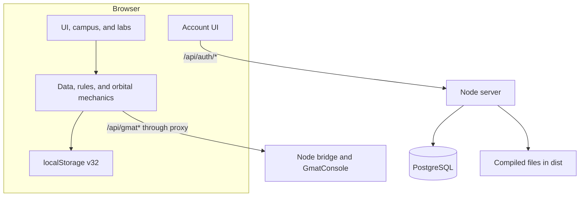

**English** | [Italiano](architecture.it.md)

# Architecture and application flows

[Index](README.md) · [Database](authentication.md) · [GMAT](gmat-integration-report.md)

## Overview

Go No-Go has three components: browser gameplay, a Node backend for files and accounts, and an optional GMAT service. Frontend assets can be built and hosted statically; account features require Node and PostgreSQL.

Vite supplies GMAT routing during development. Production `server.mjs` handles accounts but returns `404` for other unknown APIs: GMAT routing must be supplied separately.

## Frontend and script order

`index.html` contains markup and styles. Game files are **classic scripts** sharing identifiers and dependencies. The actual load order, also used by the bundle builder, is:

| Order | File in `public/game/` | Responsibility |
| --- | --- | --- |
| 1 | `00-three.js` | Local Three.js library |
| 2 | `00-toon.js` | Rendering style and helpers |
| 3 | `01-data.js` | Catalogs and game data |
| 4 | `02-orbit.js` | Orbital mechanics and calculations |
| 5 | `03-logic.js` | Rules and mission simulation |
| 6 | `04-stubs.js` | 3D editors and views, including satellite and flight |
| 7 | `05-campus.js` | Campus and facilities |
| 8 | `06-rooms.js` | Rooms and interiors |
| 9 | `08-minigames.js` | Minigames and tests |
| 10 | `07-main.js` | Startup, state, screens, saves, and integrations |

This is not alphabetical order: `08-minigames.js` comes before `07-main.js`. Keep HTML, `scripts/build-game.mjs`, and contract tests consistent when changing it.

`public/account.js` loads separately as a module and manages the account button and dialog. It does not associate game state with the authenticated user.

## Rendering and resources

The project includes a 3D campus and rooms, satellite and orbit editors, and SVG/2D views. Three.js needs WebGL. Availability checks and alternative views exist, but fallback coverage must be verified for the screen being changed.

A performance governor adjusts quality and pixel ratio, with the preference in `gngQ`. Use `?perf=1`, `?q=0..3`, and `?mob=1` for inspection. Animation considers `prefers-reduced-motion`.

Local fonts and OFL licenses live in `public/fonts/`. The page also requests Google Fonts families, so local font files do not imply zero external requests. `public/audio/theme.mp3` loads separately rather than being embedded in normal HTML.

Earth, Moon, Mars and Venus textures for the Flight Dynamics Centre live in `public/tex/` and are copied into the build. See [Image credits](../public/tex/CREDITS.md) for attribution.

## Entry before simulation

`index.html` displays the splash, styled by `public/account.css`. `public/account.js` checks `/api/auth/me` and always waits for click or keyboard activation. If necessary it shows username/password signup or login. Only after a valid session does it emit `gng-authenticated`: the game listener calls `start()` once, preserves saves and closes the initial menu to enter the campus. First-time agencies use the username. Logout revokes the session and reloads the page.

This is a UI entry rule rather than static asset protection. [Entry and accounts](entry-flow.md).

## State and persistence

`newG()` creates game object `G`; `save()` serializes it to `gng32.save`. `load()` accepts objects only when `v === 32`. Mission objects do not have a complete declared schema or a general save migration system.

The backend stores only users, sessions, and authentication limits. GMAT computations and caches are separate from the account database. Orbital results attached to missions follow the mission's local save.

See [save format](legacy-save-format.md) and [PostgreSQL schema](authentication.md) for the separate persistence models.

## Development routing

| Path/port | Destination |
| --- | --- |
| `localhost:5173` | Vite, frontend files, and development reload |
| `/api/gmat*` through Vite | `http://localhost:8787` |
| Other `/api*` through Vite | `http://127.0.0.1:8080` |
| `localhost:8080` | Node server, account APIs, and `dist/` |
| `localhost:4173` | Vite preview, without proxies defined under `server` |
| `127.0.0.1:5432` | Local Docker PostgreSQL; host port configurable with `POSTGRES_PORT` |

The GMAT proxy rule comes before the general `/api` rule. `APP_ORIGIN` refers to the origin the browser visits, normally `http://localhost:5173` during development.

## HTTP backend

`server.mjs` uses Node's native HTTP server. It serves `dist/`, delegates `/api/auth/*` to `createAuth()`, and responds to `/api/health` with `{ "status": "ok" }`.

File handling supports GET/HEAD, MIME types, precompressed or dynamic Brotli/gzip, `ETag`, `Last-Modified`, conditional requests, and `304`. It rejects invalid paths and traversal, and applies SPA fallback only to extensionless routes.

| Resource | Cache policy |
| --- | --- |
| Main HTML and `/game/*` | `no-cache` |
| `/assets/*`, `/audio/*`, `/fonts/*` | One year, `immutable` |
| Other files | One hour |
| Account APIs and JSON probe | `no-store` |

`SIGTERM`/`SIGINT` shutdown closes the server and PostgreSQL pool. Production requires account configuration; locally, the server can start without a DB and return `503` for accounts.

## Build pipeline

1. Vite compiles `index.html` and frontend modules into `dist/`.
2. `scripts/build-game.mjs` concatenates classic scripts in their defined order, minifies with esbuild, and writes `assets/game-<hash>.js`.
3. The builder replaces source script tags, adds preload, and removes `dist/game/`.
4. `scripts/precompress.mjs` generates `.br` and `.gz` text assets.
5. `scripts/verify-build.mjs`, run by `npm run check`, verifies the build contract.

`package:azure` collects the build and Node runtime files; `package:single` creates a game HTML export. Their capabilities differ: a frontend export does not embed PostgreSQL.

## Possible evolution

An ES module/TypeScript refactor could separate state, simulation, rendering, and screens. This is a proposal rather than the current layout: there is no completed new `src/` architecture replacing the classic scripts.

Before moving shared code, identify global dependencies and verify load order, saves, and actual screens. Cloud saves would require DB schema, per-user authorization, versioning, and an explicit decision on importing existing local games.
