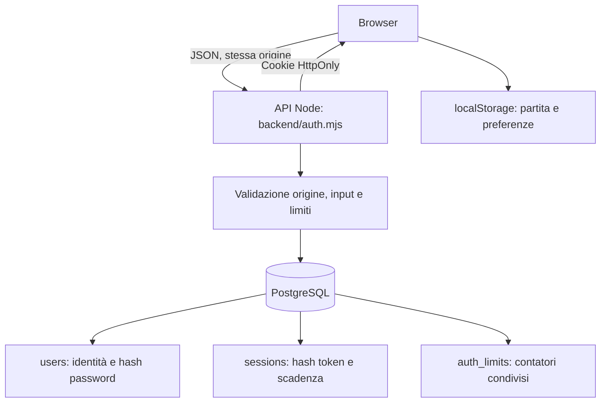
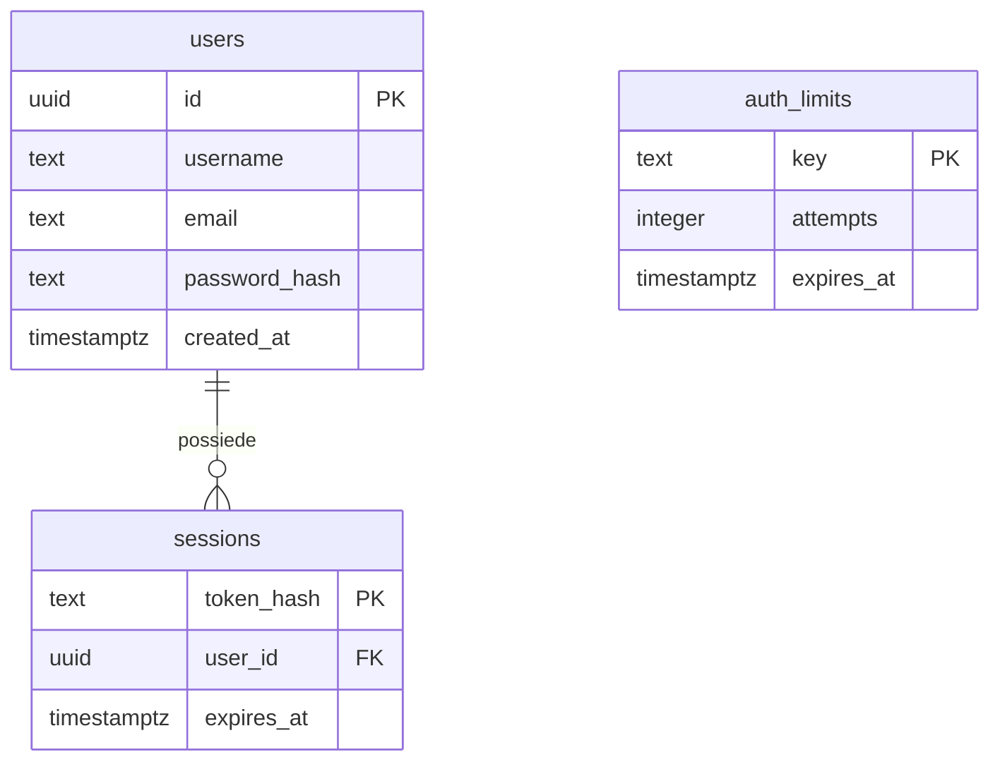

[English](authentication.md) | **Italiano**

# Account e database PostgreSQL

[Indice](README.it.md) · [Avvio completo](../README.it.md#avvio-completo-con-account) · [Salvataggi](legacy-save-format.it.md) · [Distribuzione](deployment.it.md)

## Cosa fa il database oggi

PostgreSQL gestisce **identità, sessioni e limiti ai tentativi**. Non conserva missioni, componenti, crediti, progressione o rapporti di gioco. Questi dati rimangono nel browser, nel salvataggio `gng32.save`.

La registrazione usa il backend del progetto, senza Entra External ID o un fornitore OAuth. Il login accetta username oppure email. L'interfaccia account è in `public/account.js`, separata dal motore di gioco: il giocatore può continuare come ospite.



## Schema dati

Lo schema eseguibile è [`db/001-auth.sql`](../db/001-auth.sql).



### `users`

| Campo | Regola | Significato |
| --- | --- | --- |
| `id` | UUID, chiave primaria | Generato con `randomUUID()` dal backend |
| `username` | Obbligatorio, controllo SQL sul formato | Da 3 a 24 lettere ASCII, cifre o underscore |
| `email` | Obbligatoria | Validata dal backend e salvata in minuscolo |
| `password_hash` | Obbligatorio | Valore `scrypt$sale$hash`, mai password leggibile |
| `created_at` | `timestamptz`, predefinito `now()` | Data di creazione |

Gli indici univoci su `lower(username)` e `lower(email)` impediscono duplicati anche con maiuscole diverse. L'email deve avere formato accettato dal backend e lunghezza massima di 254 caratteri; non viene verificato il possesso della casella.

### `sessions`

`token_hash` è la chiave primaria e contiene SHA-256 del token di sessione. `user_id` fa riferimento a `users.id`: eliminare un utente elimina le sue sessioni con `ON DELETE CASCADE`. `expires_at` è la scadenza assoluta.

Sono presenti indici su scadenza e utente. Una persona può avere più sessioni, per esempio su browser diversi. Login e registrazione sostituiscono soltanto la sessione indicata dal cookie della richiesta corrente, non tutte le sessioni dell'utente.

### `auth_limits`

Ogni riga contiene una chiave trasformata in SHA-256, un contatore e una scadenza. Un `INSERT ... ON CONFLICT DO UPDATE` aggiorna il contatore nel DB: i limiti sono condivisi fra processi e worker che usano lo stesso database.

Quando una finestra è scaduta, il tentativo successivo riporta il contatore a 1 e apre una nuova finestra di 15 minuti. Il successo di un login non azzera automaticamente i contatori.

## Registrazione, accesso e uscita

1. Il browser invia JSON all'API sulla stessa origine.
2. Il backend verifica metodo, origine, formato e limiti; per registrazione e login accetta al massimo 4.096 byte di corpo.
3. Alla registrazione valida username, email e password, calcola scrypt e inserisce l'utente. Username/email duplicati producono `409`.
4. Al login normalizza l'identificativo con minuscole e rimozione degli spazi esterni, cerca l'utente e confronta gli hash della password. Per utenti assenti esegue comunque un calcolo con hash fittizio.
5. Dopo registrazione o login genera **32 byte casuali**, codificati in 64 caratteri esadecimali. Salva solo SHA-256 del token, con scadenza a sette giorni, ed elimina la sessione precedente se era presente un cookie.
6. Il browser riceve il token nel cookie `gng_session`; il JSON contiene solo `{id, username, email}` dentro `user`.
7. `GET /api/auth/me` legge il cookie, cerca una sessione non scaduta tramite hash e restituisce l'utente oppure `null`.
8. Il logout elimina la sessione indicata dal cookie e invia un cookie con `Max-Age=0`.

Le operazioni di registrazione e creazione sessione sono query separate, senza una transazione comune: se la creazione sessione fallisce dopo l'inserimento, l'utente può già esistere. La scadenza non viene prolungata dalla semplice lettura di `/me`.

## Password e cookie

| Proprietà | Implementazione |
| --- | --- |
| Lunghezza password in registrazione | Da 15 a 128 caratteri, senza troncamento |
| Derivazione | scrypt, `N=32768`, `r=8`, `p=3`, `maxmem=64 MiB` |
| Sale | 16 byte casuali, codificati hex |
| Chiave derivata | 64 byte |
| Confronto | `timingSafeEqual` su buffer della stessa lunghezza |
| Parallelismo hash | Al massimo quattro calcoli attivi per processo |
| Cookie | `Path=/; HttpOnly; SameSite=Lax; Max-Age=604800` |
| Cookie in produzione | Aggiunge `Secure` |

Il frontend non conserva credenziali o token nel `localStorage`. `HttpOnly` impedisce agli script della pagina di leggere il cookie. In sviluppo `secure:false` permette HTTP locale; in produzione sono richiesti origine HTTPS e cookie `Secure`.

## Contratto API

| Metodo e percorso | Corpo | Risposta positiva |
| --- | --- | --- |
| `POST /api/auth/register` | `{ "username": "Pilota", "email": "pilota@example.com", "password": "una frase lunga e unica" }` | `201`, `{ "user": { "id": "…", "username": "Pilota", "email": "pilota@example.com" } }` e cookie |
| `POST /api/auth/login` | `{ "login": "Pilota", "password": "una frase lunga e unica" }` | `200`, utente pubblico e cookie |
| `GET /api/auth/me` | Nessuno | `200`, `{ "user": ... }` oppure `{ "user": null }` |
| `POST /api/auth/logout` | L'interfaccia invia `{}` | `200`, `{ "user": null }` e cancellazione cookie |

Tutti i POST account richiedono `Origin` esattamente uguale a `APP_ORIGIN`. Registrazione e login richiedono `Content-Type: application/json`; il logout viene gestito prima del controllo del formato del corpo. Non è abilitato CORS. Le risposte account hanno `Cache-Control: no-store`.

| Stato | Significato |
| --- | --- |
| `400` | JSON, formato o campi non validi |
| `401` | Credenziali errate |
| `403` | Origine diversa da quella configurata |
| `404` | Endpoint non previsto |
| `405` | Metodo non consentito |
| `409` | Conflitto sui dati di registrazione |
| `413` | Corpo oltre 4 KiB |
| `415` | Formato del corpo non supportato |
| `429` | Troppi tentativi |
| `503` | Account non configurati, DB/schema indisponibile o errore del servizio account |

`/me` esegue anche una query su `users` prima di verificare la sessione: una risposta positiva senza cookie indica che la connessione e almeno la tabella utenti sono raggiungibili. Non verifica da sola tutte le operazioni di registrazione, sessione o limitazione.

## Limiti ai tentativi

| Chiave logica | Soglia per finestra di 15 minuti |
| --- | --- |
| Indirizzo del peer TCP | 100 richieste registrazione/login che raggiungono il controllo |
| Identificativo login normalizzato | 10 tentativi |
| Registrazioni globali | 30 tentativi di registrazione validi che raggiungono il controllo |

Il tentativo oltre soglia riceve `429`. I limiti non riguardano `/me` e logout. Il codice usa `req.socket.remoteAddress`, senza fidarsi di `X-Forwarded-For`: dietro un proxy, più visitatori possono condividere il limite del peer. Un eventuale adattamento ai proxy fidati richiede una modifica esplicita del backend.

## Connessione PostgreSQL

[`backend/database.mjs`](../backend/database.mjs) crea un pool `pg` con **massimo cinque connessioni per processo** e timeout di connessione di **5 secondi**. Più istanze dell'applicazione possono quindi aprire ciascuna fino a cinque connessioni.

`DATABASE_URL` è obbligatoria per creare il pool. Il codice rimuove `sslmode` dalla URL e usa la propria configurazione TLS: `DATABASE_SSL=false` disabilita TLS soltanto fuori produzione; negli altri casi il certificato viene verificato con `rejectUnauthorized:true`.

| Variabile | Uso |
| --- | --- |
| `DATABASE_URL` | URL PostgreSQL; codificare correttamente i caratteri speciali delle credenziali |
| `DATABASE_SSL` | `false` per PostgreSQL Docker locale; TLS attivo negli altri casi |
| `APP_ORIGIN` | Origine esatta, senza percorso o slash finale |
| `NODE_ENV` | `production` rende obbligatori DB, TLS e origine HTTPS |
| `PORT` | Porta del backend, predefinita 8080 |

L'avvio del processo crea il pool ma non applica migrazioni né garantisce connettività DB. `GET /api/health` è una sonda del processo, non del database.

## Avvio e migrazioni

La procedura completa è nel [README](../README.it.md#avvio-completo-con-account). I comandi essenziali sono:

```powershell
docker compose -f compose.yaml up -d --wait postgres
# Solo se non esiste già una configurazione da conservare:
Copy-Item .env.example .env
npm run db:migrate
npm run dev:api
```

Il servizio locale usa PostgreSQL 17, porta esposta soltanto su `127.0.0.1:5432` e volume `postgres-data`. Nel secondo terminale avvia `npm run dev` e usa l'origine `http://localhost:5173` prevista da `.env.example`.

`npm run db:migrate` carica `.env`, legge l'unico file SQL e lo esegue dentro `BEGIN/COMMIT`, poi chiude il pool. La migrazione è ripetibile grazie a `IF NOT EXISTS`.

**Non esiste ancora un registro di migrazioni né un esecutore di file numerati.** Modificare `001-auth.sql` non aggiorna automaticamente colonne o vincoli già esistenti. Per evoluzioni future occorre introdurre vere migrazioni di alterazione e aggiornare anche l'esecutore; aggiungere soltanto un secondo file SQL non basta.

## Azure e privilegi

Esegui il provisioning separatamente per staging e produzione con `infra/azure-database.sh`. Richiede `RG`, `PG_SERVER`, `WEBAPP`, `PG_ADMIN_PASSWORD`; accetta `LOCATION`, `PG_ADMIN` e `PG_DATABASE`. Lo script definisce PostgreSQL 17 Flexible Server, SKU `Standard_B1ms`, 32 GiB e backup di sette giorni e apre il firewall agli IP di uscita possibili della Web App.

Queste sono impostazioni dello script, non una verifica delle risorse realmente distribuite. Disponibilità, costi e policy della subscription vanno verificati nell'ambiente destinazione. Il provisioning non applica lo schema né imposta automaticamente tutte le variabili della Web App.

Usa `DATABASE_SSL=true`, `NODE_ENV=production`, una `APP_ORIGIN` HTTPS esatta e credenziali specifiche dell'ambiente. Non inserire stringhe DB in Git, variabili frontend o log. Separa il ruolo amministrativo/migrazioni dal ruolo applicativo, che necessita di `CONNECT`, `USAGE` e operazioni sui dati delle tre tabelle, non di creazione dello schema.

La [guida distribuzione](deployment.it.md) descrive l'ordine provisioning → configurazione → migrazione → deploy → collaudo.

## Manutenzione

La scadenza è verificata durante l'uso, ma non esiste un processo automatico che elimini le righe scadute. Un job amministrativo può eseguire periodicamente:

```sql
DELETE FROM sessions WHERE expires_at <= now();
DELETE FROM auth_limits WHERE expires_at <= now();
```

Query di controllo senza esporre credenziali o token:

```sql
SELECT count(*) AS utenti FROM users;
SELECT count(*) AS sessioni_attive FROM sessions WHERE expires_at > now();
SELECT count(*) AS limiti_scaduti FROM auth_limits WHERE expires_at <= now();
```

Verifica backup e ripristino prima delle modifiche strutturali. Un rollback del codice non ripristina il database. I dati locali del browser richiedono un backup distinto: non sono inclusi nei backup PostgreSQL.

## Limiti attuali e collaudo

Non sono implementati verifica email, recupero password, MFA, pagina amministrativa, cancellazione account autonoma, salvataggio cloud o sincronizzazione missioni. La cancellazione SQL di un utente elimina le sue sessioni, ma non cancella il `localStorage` dei suoi browser. Il logout non elimina il salvataggio e non esce dalle altre sessioni.

I test account usano PGlite temporaneo; non dimostrano connettività TLS, firewall o persistenza del vero server Azure. Lo smoke browser `node scripts/smoke-account.mjs` prova registrazione, ricaricamento, uscita, accesso e cookie su un DB temporaneo. In staging verifica anche persistenza dopo riavvio dell'app e separazione dal DB di produzione. Vedi [verifiche](testing.it.md).
