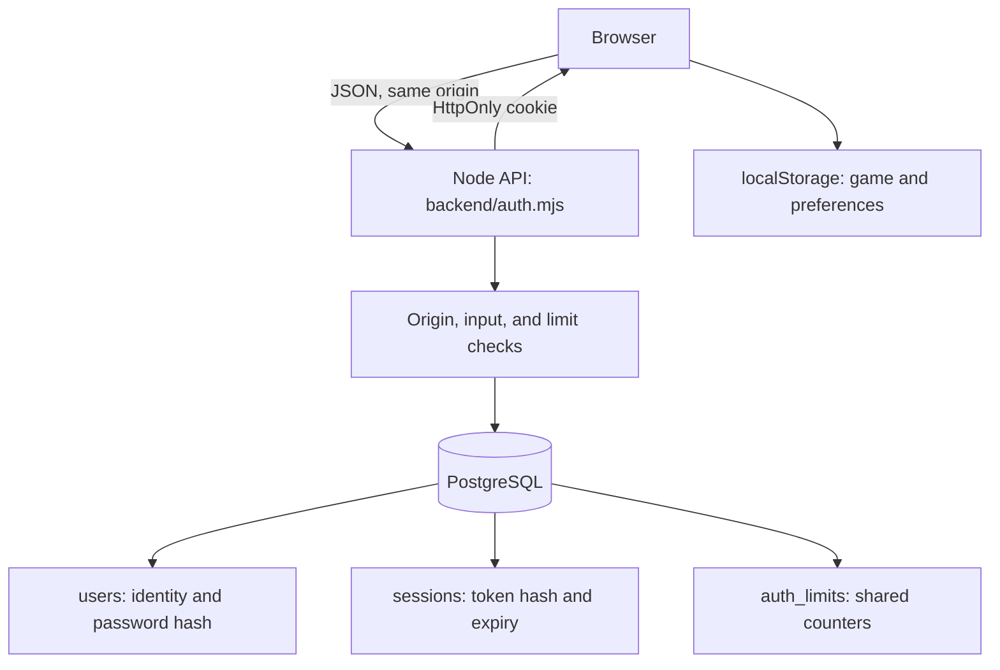
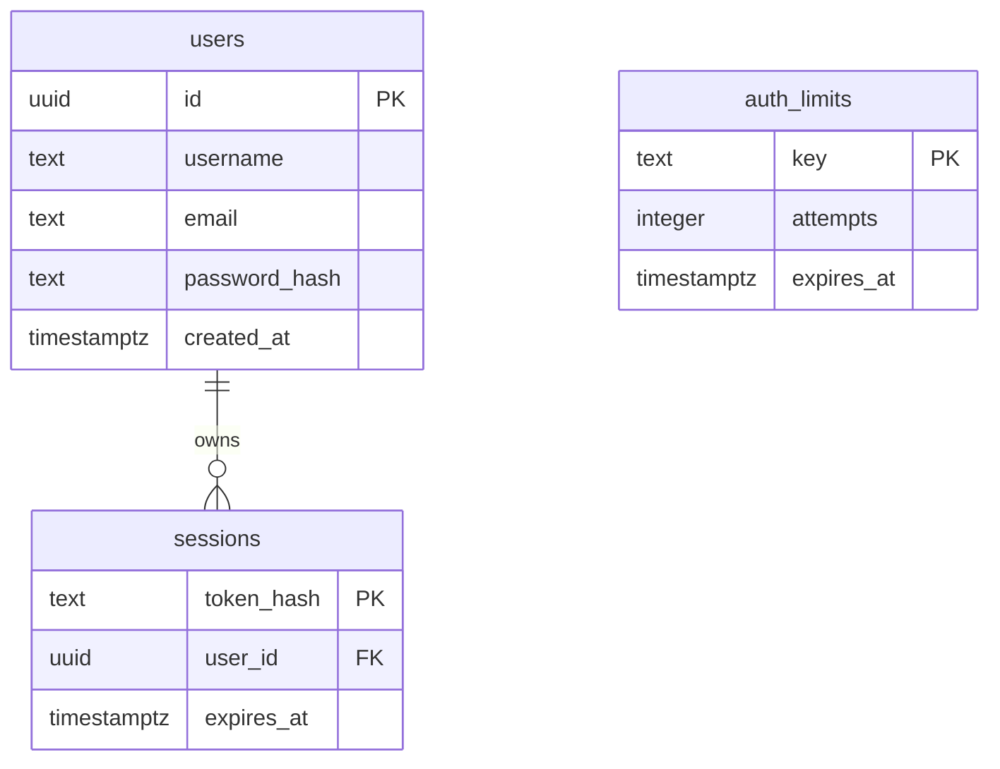

**English** | [Italiano](authentication.it.md)

# Accounts and PostgreSQL database

[Index](README.md) · [Full setup](../README.md#full-setup-with-accounts) · [Saves](legacy-save-format.md) · [Deployment](deployment.md)

## What the database does today

PostgreSQL manages **identity, sessions, and request limits**. It does not store missions, components, credits, progression, or gameplay reports. Those remain in browser `localStorage`, under `gng32.save`.

Registration uses the project's own backend, without Entra External ID or an OAuth provider. The UI asks only for username and password; the API retains email login for existing users. `public/account.js` requires an account before starting the game engine.



## Data schema

The initial schema is [`db/001-auth.sql`](../db/001-auth.sql); [`db/002-username-accounts.sql`](../db/002-username-accounts.sql) makes email optional while preserving existing users.



### `users`

| Field | Rule | Meaning |
| --- | --- | --- |
| `id` | UUID primary key | Generated by backend `randomUUID()` |
| `username` | Required, SQL format check | 3–24 ASCII letters, digits, or underscores |
| `email` | Optional, `NULL` for new UI accounts | If supplied, validated and stored in lowercase |
| `password_hash` | Required | `scrypt$salt$hash`, never readable passwords |
| `created_at` | `timestamptz`, defaults to `now()` | Creation timestamp |

Unique indexes on `lower(username)` and `lower(email)` prevent case-insensitive duplicates. If provided, email must satisfy backend format checks and be at most 254 characters; mailbox ownership is not verified.

### `sessions`

`token_hash` is the primary key and stores SHA-256 of the session token. `user_id` references `users.id` with `ON DELETE CASCADE`, so deleting a user deletes their sessions. `expires_at` is an absolute expiry timestamp.

Indexes cover expiry and user. A user can have several sessions, for example in different browsers. Login and registration replace only the session identified by the request's current cookie, rather than all of that user's sessions.

### `auth_limits`

Each row stores a SHA-256 key, counter, and expiry. `INSERT ... ON CONFLICT DO UPDATE` updates counters in PostgreSQL, sharing limits across processes and workers using the same DB.

After expiry, the next attempt resets the counter to 1 and starts a new 15-minute window. Successful login does not automatically reset counters.

## Registration, login, and logout

1. The browser sends JSON to a same-origin API.
2. The backend validates method, origin, format, and limits; registration and login accept at most 4,096 body bytes.
3. Registration validates username, password and any supplied email, derives the password hash, and inserts the user. Duplicate username/email produces `409`.
4. Login lowercases and trims the identifier, looks up the user, and compares password hashes. Missing users still cause a comparison using a dummy hash.
5. After registration or login, the backend generates **32 random bytes**, encoded as 64 hexadecimal characters. It stores only SHA-256 of the token with a seven-day expiry and deletes the prior session when a cookie was supplied.
6. The browser receives `gng_session`; JSON exposes only `{id, username, email}` inside `user`.
7. `GET /api/auth/me` reads the cookie, looks up an unexpired session by hash, and returns a user or `null`.
8. Logout deletes the session identified by the cookie and sets the cookie's `Max-Age=0`.

User insertion and session creation are separate queries, without a shared transaction. If session creation fails after registration inserts the user, that user may already exist. Calling `/me` does not extend expiry.

## Passwords and cookies

| Property | Implementation |
| --- | --- |
| Registration password length | 15–128 characters, without truncation |
| Derivation | scrypt, `N=32768`, `r=8`, `p=3`, `maxmem=64 MiB` |
| Salt | 16 random bytes, hex encoded |
| Derived key | 64 bytes |
| Comparison | `timingSafeEqual` on equal-length buffers |
| Hash concurrency | At most four active calculations per process |
| Cookie | `Path=/; HttpOnly; SameSite=Lax; Max-Age=604800` |
| Production cookie | Adds `Secure` |

The frontend does not keep credentials or tokens in `localStorage`. `HttpOnly` prevents page scripts from reading the cookie. Local development uses `secure:false` to allow HTTP; production requires HTTPS origin and `Secure` cookies.

## API contract

| Method and path | Body | Successful response |
| --- | --- | --- |
| `POST /api/auth/register` | `{ "username": "Pilot", "password": "a long and unique phrase" }` | `201`, `{ "user": { "id": "…", "username": "Pilot", "email": null } }` and cookie |
| `POST /api/auth/login` | `{ "login": "Pilot", "password": "a long and unique phrase" }` | `200`, public user and cookie |
| `GET /api/auth/me` | None | `200`, `{ "user": ... }` or `{ "user": null }` |
| `POST /api/auth/logout` | UI sends `{}` | `200`, `{ "user": null }` and cookie removal |

All account POSTs require `Origin` to match `APP_ORIGIN` exactly. Registration and login require `Content-Type: application/json`; logout is handled before the body format check. CORS is not enabled. Account responses use `Cache-Control: no-store`.

| Status | Meaning |
| --- | --- |
| `400` | Invalid JSON, format, or fields |
| `401` | Invalid credentials |
| `403` | Origin mismatch |
| `404` | Unknown endpoint |
| `405` | Method not allowed |
| `409` | Registration data conflict |
| `413` | Body exceeds 4 KiB |
| `415` | Unsupported body format |
| `429` | Too many attempts |
| `503` | Accounts not configured, DB/schema unavailable, or account service failure |

`/me` queries `users` before checking the session. Success without a cookie shows that the connection and at least the users table are reachable; it does not exercise every registration, session, or limit operation.

## Request limits

| Logical key | Threshold per 15-minute window |
| --- | --- |
| TCP peer address | 100 registration/login requests reaching that check |
| Normalized login identifier | 10 attempts |
| Global registrations | 30 valid registration attempts reaching that check |

Attempts above the threshold receive `429`. `/me` and logout are not subject to these limits. The code uses `req.socket.remoteAddress` and does not trust `X-Forwarded-For`. Behind a proxy, visitors can share the peer limit; supporting trusted proxies requires an explicit backend change.

## PostgreSQL connection

[`backend/database.mjs`](../backend/database.mjs) creates a `pg` pool with **at most five connections per process** and a **5-second connection timeout**. Multiple application instances can each open up to five connections.

Creating the pool requires `DATABASE_URL`. The code removes URL `sslmode` and supplies its own TLS settings: `DATABASE_SSL=false` disables TLS only outside production; otherwise certificates are validated with `rejectUnauthorized:true`.

| Variable | Purpose |
| --- | --- |
| `DATABASE_URL` | PostgreSQL URL; correctly encode credential special characters |
| `DATABASE_SSL` | `false` for local Docker PostgreSQL; otherwise TLS enabled |
| `APP_ORIGIN` | Exact origin without path or trailing slash |
| `NODE_ENV` | `production` requires DB, TLS, and HTTPS origin |
| `PORT` | Backend port, defaults to 8080 |

Startup creates the pool but neither applies migrations nor guarantees DB connectivity. `GET /api/health` is a process probe, not a database check.

The form accepts `{username,password}` without email. Multiple `NULL` emails are allowed while supplied emails remain unique. [Entry and accounts](entry-flow.md).

## Startup and migrations

See the [README](../README.md#full-setup-with-accounts) for the complete procedure. Essential commands:

```powershell
docker compose -f compose.yaml up -d --wait postgres
# Only if there is no existing configuration to preserve:
Copy-Item .env.example .env
npm run db:migrate
npm run dev:api
```

Local PostgreSQL 17 exposes `127.0.0.1:5432` only and uses `postgres-data`. Start `npm run dev` in another terminal and visit the `.env.example` origin, `http://localhost:5173`.

`npm run db:migrate` loads `.env`, applies `001-auth.sql` then `002-username-accounts.sql` within `BEGIN/COMMIT`, and closes the pool. Both are repeatable; the second executes `ALTER TABLE users ALTER COLUMN email DROP NOT NULL`. It does not remove accounts, existing email addresses or sessions.

There is no applied-migration ledger: the list is explicit in `backend/database.mjs`. New migrations must also be added to that list. Editing `CREATE TABLE IF NOT EXISTS` alone does not alter existing tables.

The PostgreSQL host port is configurable with `POSTGRES_PORT` (default `5432`). If choosing `15432`, also update the port in `DATABASE_URL` and rerun `docker compose -f compose.yaml up -d --wait postgres`. Never commit local `.env`.

## Azure and privileges

Run `infra/azure-database.sh` separately for staging and production. It requires `RG`, `PG_SERVER`, `WEBAPP`, and `PG_ADMIN_PASSWORD`, and accepts `LOCATION`, `PG_ADMIN`, and `PG_DATABASE`. The script defines PostgreSQL 17 Flexible Server, `Standard_B1ms`, 32 GiB, seven-day backups, and firewall rules for the Web App's possible outbound IPs.

These are script settings, not a check of deployed resources. Verify availability, costs, and subscription policies in the target environment. Provisioning does not apply the schema or configure every Web App setting automatically.

Use `DATABASE_SSL=true`, `NODE_ENV=production`, an exact HTTPS `APP_ORIGIN`, and environment-specific credentials. Do not put DB URLs in Git, frontend variables, or logs. Separate administrator/migration roles from an application role requiring `CONNECT`, `USAGE`, and data operations on the three tables rather than schema creation.

The [deployment guide](deployment.md) covers provisioning → configuration → migration → deploy → validation.

## Maintenance

Expiry is enforced when used, but no automatic job removes expired rows. An administrative job can periodically run:

```sql
DELETE FROM sessions WHERE expires_at <= now();
DELETE FROM auth_limits WHERE expires_at <= now();
```

Operational queries without exposing credentials or tokens:

```sql
SELECT count(*) AS users_total FROM users;
SELECT count(*) AS active_sessions FROM sessions WHERE expires_at > now();
SELECT count(*) AS expired_limits FROM auth_limits WHERE expires_at <= now();
```

Verify backup and restore before structural changes. Code rollback does not restore the DB. Browser missions need separate backup because PostgreSQL backups do not include them.

## Current limitations and validation

Email verification, password recovery, MFA, administration UI, self-service deletion, cloud saves, and mission synchronization are not implemented. SQL deletion of a user deletes their sessions but not browser `localStorage`. Logout neither deletes missions nor signs out other sessions.

Account tests use temporary PGlite rather than proving real Azure TLS, firewall, or persistence behavior. `node scripts/smoke-account.mjs` checks registration, reload, logout, login, and cookies with a temporary DB. In staging, also verify persistence after restarting the app and separation from production data. See [testing](testing.md).
